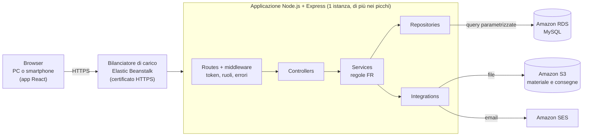
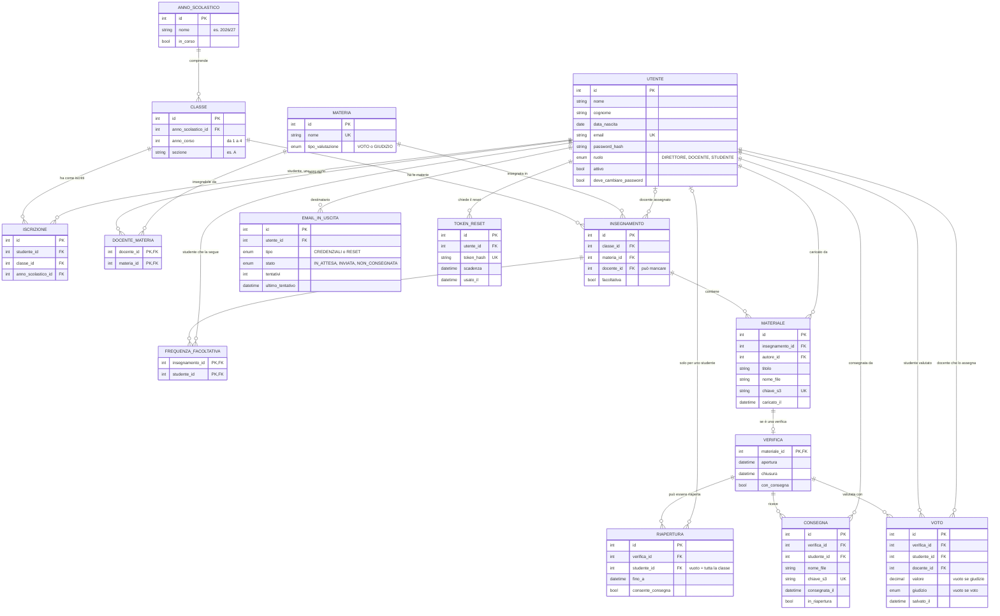

# PRD di ScuolaChill · Matteo Padesi

## Informazioni sul documento

|              |                                      |
| ------------ | ------------------------------------ |
| **Prodotto** | ScuolaChill                          |
| **Team**     | Matteo Padesi — sviluppo individuale |
| **Autori**   | Matteo Padesi                        |
| **Versione** | _1.0_                                |
| **Data**     | 23/09/2026                           |
| **Stato**    | Bozza                                |

### Storico delle versioni

| Versione | Data       | Autore        | Cosa è cambiato e perché |
| -------- | ---------- | ------------- | ------------------------ |
| 1.0      | 23/09/2026 | Matteo Padesi | Prima stesura            |

---

# Prima parte · Il cosa

## Scopo e perimetro

### Perché esiste ScuolaChill

**Dal lato business.** A scuola materiale didattico, verifiche e voti passano spesso da strumenti diversi: email, chat, cartelle condivise, moduli online. ScuolaChill li riunisce in un solo posto. Il Direttore vede l'andamento della scuola senza chiedere i dati a ogni docente. I docenti preparano materiale, verifiche e voti senza fare lo stesso lavoro due volte. Gli studenti trovano in un'unica app, anche da smartphone, tutto ciò che serve per studiare e i propri voti.

**Dal lato tecnico.** Il sistema copre principalmente quattro aree: account e classi, materiale didattico, verifiche, voti e medie. Ogni utente vede solo ciò che serve al suo ruolo: Direttore, Docente o Studente. Si usa dal browser, sia da PC sia da smartphone, ed è pubblicato su internet, così che possa essere collaudato da utenti reali.

### Cosa è incluso

- Accesso (login e logout) con account creati dal Direttore: nessuno si registra da solo
- Recupero della password dimenticata via email
- Creazione degli account di docenti e studenti da parte del Direttore, con invio via email delle credenziali di primo accesso
- Gestione delle classi: composizione, assegnazione dei docenti per materia, trasferimento degli studenti, materie facoltative come religione
- Panoramica della scuola per il Direttore: classi, docenti, studenti, andamento dei voti
- Caricamento del materiale didattico da parte dei docenti e consultazione da parte degli studenti, per classe e materia
- Verifiche: materiale che il docente segna come verifica, con un orario di apertura e uno di chiusura, l'eventuale consegna dell'elaborato da parte dello studente e la riapertura a scelta del docente
- Voti da 1 a 10 con "+", "½" e "−", giudizi per religione e attività alternativa, medie per studente, classe e materia
- Passaggio al nuovo anno scolastico, con archivio degli anni precedenti

### Cosa non è incluso

- **Scrutini, pagelle e registro ufficiale.** Le medie di ScuolaChill servono a orientarsi e non hanno valore ufficiale.
- **Genitori.** Non hanno un account, e ScuolaChill non invia comunicazioni alle famiglie.
- **Messaggi fra utenti.** ScuolaChill non è uno strumento per comunicare: niente chat né bacheche.
- **Assenze, presenze e giustificazioni.**
- **Orario delle lezioni e calendario.**
- **Rette e pagamenti.**

---

## Stakeholder

| Stakeholder                 | Cosa fa                                                                   | Cosa gli interessa                                          | Come lo coinvolgete                   |
| --------------------------- | ------------------------------------------------------------------------- | ----------------------------------------------------------- | ------------------------------------- |
| Direttore                   | Dirige la scuola, crea account e classi, ha visione d'insieme             | Poco tempo, vuole vedere tutto senza entrare in ogni pagina | Intervista + collaudo finale          |
| Docenti                     | Insegna una o più materie, carica materiale, crea verifiche, assegna voti | Fare le operazioni quotidiane senza attrito                 | Collaudo con un docente reale         |
| Studenti                    | Consulta materiale, svolge verifiche, controlla i voti                    | Trovare tutto in un posto, non perdere voti                 | Collaudo con i ragazzi del primo anno |
| Docente del corso           | Valida il PRD                                                             | Che le scelte siano motivate e coerenti fra loro            | Presentazione e domande               |
| Collaudatori del primo anno | Usano ScuolaChill come utenti reali                                       | Che sia semplice da usare, anche da smartphone              | _Intervista, collaudo_                |
| _Altri?_                    |                                                                           |                                                             |                                       |

---

## Destinatari e contesto d'uso

### La scuola che avete immaginato

Progetto ScuolaChill per un istituto reale, quello che frequento: il **CFP Don Bosco** di San Donà di Piave.

- **Molte ore si passano in laboratorio**, nei settori elettrico, termoidraulico, informatico, meccanico e automotive. Docenti e studenti non sono sempre seduti davanti a un computer, quindi lo smartphone conta quanto il PC.
- **I percorsi non durano tutti uguale**: alcuni finiscono dopo tre anni, altri dopo quattro.

|                    | Valore                                                                                                                                                                                   |
| ------------------ | ---------------------------------------------------------------------------------------------------------------------------------------------------------------------------------------- |
| Tipo di istituto   | Centro di formazione professionale (IeFP)                                                                                                                                                |
| Percorsi           | 10: cinque qualifiche di tre anni e cinque diplomi di quattro anni                                                                                                                       |
| Numero di studenti | 900 _(stima, ASS-01)_                                                                                                                                                                    |
| Numero di docenti  | 40 _(stima, ASS-01)_                                                                                                                                                                     |
| Numero di classi   | 36, in media 25 studenti ciascuna _(stima, ASS-01)_                                                                                                                                      |
| Orario scolastico  | Lezioni la mattina, dalle 8:00 alle 13:00, sei giorni su sei (lunedì–sabato); in due o tre pomeriggi a settimana si torna per i laboratori                                               |
| Connettività       | Una sola rete Wi-Fi della scuola, in comune fra aule e laboratori, che rallenta quando molti dispositivi sono collegati. Per questo molti usano la connessione dati del proprio telefono |

### Gli archetipi

Arricchisci gli archetipi della traccia.

| ID      | Archetipo | Contesto d'uso                                                      | Competenze digitali                                                                | Dispositivo principale       | Frequenza d'uso                                                                                                               |
| ------- | --------- | ------------------------------------------------------------------- | ---------------------------------------------------------------------------------- | ---------------------------- | ----------------------------------------------------------------------------------------------------------------------------- |
| ARC-001 | Direttore | Ufficio, tempo limitato                                             | Medie, abituato a usare il PC per lavoro, vuole comunque viste rapide e sintetiche | PC                           | Più volte a settimana, con picchi a inizio anno (creazione classi) e sessioni più brevi per avere una panoramica della scuola |
| ARC-002 | Docente   | In classe o a casa                                                  | Variabili, sopratutto in base all'età                                              | PC (principale) e smartphone | Più volte a settimana, con picchi dopo ogni verifica (assegnazione voti)                                                      |
| ARC-003 | Studente  | A scuola fra le lezioni, durante l'intervallo o a casa per studiare | Alte, sopratutto per quanto riguarda lo smartphone                                 | PC e smartphone (principale) | giornaliera, uso sia breve (vedere voti), che lungo (vedere materiale scolastico)                                             |

---

## Panoramica e casi d'uso

### ScuolaChill in poche righe

ScuolaChill è il posto unico in cui la scuola gestisce materiale, verifiche e voti. A inizio anno il Direttore crea gli account e le classi, e da una sola pagina vede come va la scuola: le classi, i docenti, l'andamento dei voti. I docenti caricano il materiale e le verifiche, decidono quando una verifica si apre e si chiude, e registrano i voti. Gli studenti trovano tutto in un posto, anche dal telefono: il materiale per studiare, le verifiche da svolgere e consegnare, i propri voti con le medie. A fine anno, con pochi passaggi, le classi passano all'anno successivo senza perdere nulla.

### User flow e scenari

#### Direttore (ARC-001)

**DIR-01 — Creare account docente:** Come Direttore voglio creare gli account dei docenti così da dare al personale l'accesso al sistema con il ruolo corretto.

**User flow**

1. Il direttore accede a Scuola Chill
2. Apre la sezione "crea account"
3. Sceglie "docente"
4. Scrive nome, cognome, data di nascita ed email. Poi sceglie da un elenco le materie che il docente insegna (sono le materie della scuola, vedi DIR-03) e, se sono già decise, le classi in cui le insegna. Le classi sono opzionali: se mancano, il sistema lo ricorda al Direttore più avanti. È la stessa assegnazione che si fa componendo una classe (DIR-03): farla da una parte la rende visibile anche dall'altra
5. Se un campo è vuoto o non valido, il sistema lo evidenzia e non crea l'account; altrimenti crea l'account con ruolo Docente e lo aggiunge all'elenco dei docenti
6. Al docente arriva una mail con un link per accedere alla piattaforma e le credenziali di primo accesso, con una password temporanea (se la mail non parte vale FR-EST-01)

**Scenario principale.** A scuola arriva un nuovo docente di matematica. Il direttore crea un nuovo account docente inserendo i suoi dati, mette "matematica" come materia e salta la sezione riguardante le classi per farla in seguito non appena sarà deciso in che classe farlo insegnare. Una volta conclusa la creazione del nuovo account, al nuovo docente arriva una mail con link e credenziali del suo account. Il nuovo docente apre il link che lo porta direttamente nella schermata di accesso e inserisce le credenziali scritte nella mail. ScuolaChill gli chiede subito di sostituire la password temporanea con una sua; fatto questo, accede al suo account personale.

**Scenari alternativi.**

- **Email già usata.** Il Direttore inserisce un'email che appartiene già a un altro utente: il sistema lo segnala e non crea nessun account (AC-02).
- **Dati mancanti o sbagliati.** Il Direttore dimentica il cognome o scrive un'email non valida: il sistema evidenzia il campo da correggere e non crea l'account.
- **L'email non parte.** Il servizio che invia le email non risponde: l'account viene creato lo stesso e il sistema riprova da solo. Se non ci riesce, il Direttore vede "email non consegnata" e può reinviarla o consegnare le credenziali di persona (FR-EST-01).
- **Utente senza permesso.** Un docente o uno studente prova a creare un account, anche senza passare dalle pagine dell'app: l'operazione viene negata (AC-03).

**DIR-02 — Creare account studente:** Come Direttore voglio creare gli account degli studenti così da permettere a ogni iscritto di usare l'applicazione.

**User flow**

1. Il Direttore accede a ScuolaChill
2. Apre la sezione "crea account"
3. Sceglie "studente"
4. Scrive nome, cognome, data di nascita ed email e, se è già decisa, sceglie la classe da un menu con le classi dell'anno in corso. La classe è opzionale: se manca, il sistema lo ricorda al Direttore più avanti. Scegliere qui la classe equivale ad aggiungere lo studente alla classe in DIR-03, con le stesse regole (FR-CLA-01)
5. Se un campo è vuoto o non valido, il sistema lo evidenzia e non crea l'account; altrimenti crea l'account con ruolo Studente e lo aggiunge all'elenco degli studenti
6. Allo studente arriva una mail con un link per accedere alla piattaforma e le credenziali di primo accesso, con una password temporanea (se la mail non parte vale FR-EST-01)

**Scenario principale.** A scuola si iscrive un nuovo studente. Il direttore crea un nuovo account studente inserendo i suoi dati, salta la sezione riguardante la classe e la aggiungerà in seguito non appena avrà deciso in che classe inserirlo. Una volta conclusa la creazione del nuovo account, al nuovo studente arriva una mail con link e credenziali del suo account. Il nuovo studente apre il link che lo porta direttamente nella schermata di accesso e inserisce le credenziali scritte nella mail. ScuolaChill gli chiede subito di sostituire la password temporanea con una sua; fatto questo, accede al suo account personale.

**Scenari alternativi.**

- **Dati incompleti.** Il Direttore conferma senza la data di nascita e con un'email scritta male: il sistema indica esattamente quali campi correggere e non crea l'account (AC-02).
- **Email già usata.** L'email appartiene già a un altro utente: il sistema lo segnala e non crea l'account.
- **L'email non parte.** A settembre il Direttore crea gli account di tutte le prime, ma il servizio delle email ha un guasto: gli account vengono creati lo stesso, e per quelli rimasti senza email il Direttore può reinviarla più tardi o consegnare le credenziali di persona (FR-EST-01).
- **Utente senza permesso.** Un docente o uno studente prova a creare uno studente: l'operazione viene negata (AC-03).

**DIR-03 — Creare classi e comporle:** Come Direttore voglio creare le classi e assegnarvi studenti e docenti con le rispettive materie così da riprodurre l'organizzazione reale della scuola.

**User flow**

1. Il Direttore accede a ScuolaChill
2. Apre la sezione "Classi" e preme "Nuova classe"
3. Sceglie l'anno di corso (1ª, 2ª, 3ª o 4ª) e scrive la sezione (es. A). Il nome della classe (es. 1A) si compone da solo. L'anno scolastico non si inserisce: la classe appartiene sempre all'anno scolastico in corso (FR-ANN-01). Nello stesso anno scolastico non possono esistere due classi con lo stesso nome
4. Nella pagina della classe preme "Aggiungi studenti": si apre l'elenco degli studenti, che può cercare per nome o cognome e filtrare per vedere solo quelli ancora senza classe. Spunta gli studenti da aggiungere e preme "Aggiungi"
5. Preme "Aggiungi materia" e sceglie una materia dall'elenco delle materie della scuola. Accanto alla materia sceglie il docente da un menu che mostra solo i docenti che la insegnano (opzionale: si può fare anche dopo). È la stessa assegnazione che si può fare creando l'account del docente (DIR-01)
6. Se la materia è facoltativa (es. religione), la segna come tale e spunta gli studenti che la seguono (FR-MAT-01)
7. Preme "Salva"; la classe compare nell'elenco con il numero di studenti
8. Se uno studente è già in un'altra classe, il sistema lo segnala e propone il trasferimento (FR-CLA-01)

**Le materie della scuola.** L'elenco delle materie (es. italiano, elettrotecnica, religione) lo crea il Direttore una volta sola, nella sezione "Materie": per ognuna scrive il nome e sceglie se si valuta con voto o con giudizio (FR-VOT-02). Lo stesso elenco si usa qui e nella creazione degli account dei docenti (DIR-01).

**Scenario principale.** A settembre il Direttore deve creare le classi prime. Le altre classi sono già pronte, perché il passaggio al nuovo anno (FR-ANN-01) le ha create partendo da quelle dell'anno prima. Preme "Nuova classe", sceglie 1ª e scrive la sezione A. Con "Aggiungi studenti" filtra gli studenti ancora senza classe e spunta i 25 nuovi iscritti. Con "Aggiungi materia" inserisce le materie della prima e accanto a ognuna sceglie il docente, saltando quelle per cui non sa ancora chi insegnerà: ScuolaChill gliele ricorderà più avanti. Preme "Salva", e la 1A compare nell'elenco delle classi con 25 studenti.

**Scenari alternativi.**

- **Nome già usato.** Esiste già una 1A nello stesso anno scolastico: il sistema lo segnala e non crea la classe.
- **Studente già in un'altra classe.** Il Direttore aggiunge alla 1A uno studente che è già in 1B: il sistema glielo segnala e propone il trasferimento, che va confermato (FR-CLA-01).
- **Materie senza docente.** La classe viene creata lo stesso; finché manca un docente, ScuolaChill lo ricorda al Direttore.
- **Materia facoltativa.** Per religione il Direttore indica solo gli studenti che la seguono; gli altri non la vedranno (FR-MAT-01).
- **Utente senza permesso.** Un docente prova a creare una classe o a spostare uno studente: l'operazione viene negata.

**DIR-04 — Vedere tutto:** Come Direttore voglio una vista complessiva su classi, docenti, studenti e voti così da monitorare l'andamento della scuola senza entrare in ogni singola pagina.

**User flow**

1. Il Direttore accede a ScuolaChill
2. Apre la "Panoramica"
3. Vede in una sola pagina: le classi con il numero di studenti, i docenti con le loro materie, l'andamento dei voti (medie per classe e per materia, FR-VOT-03)
4. Se vuole i dettagli, apre un elenco completo, diviso in pagine

**Scenario principale.** Il Direttore ha dieci minuti prima di una riunione con i docenti. Dal PC dell'ufficio apre la Panoramica e in una sola pagina vede le 36 classi con il numero di studenti, i 40 docenti con le loro materie e le medie per classe e per materia. Nota che in matematica la media della 2B è più bassa di quella delle altre seconde, apre il dettaglio della classe e arriva alla riunione con il dato già pronto.

**Scenari alternativi.**

- **Elenco lungo.** L'elenco dei 900 studenti è diviso in pagine, e il Direttore le scorre una alla volta (AC-02).
- **Classe ancora senza voti.** A inizio anno la 1A non ha voti: la media non compare, invece di mostrare "0" (FR-VOT-03).
- **Materie con giudizio.** Religione e attività alternativa compaiono a parte, senza media (FR-VOT-02).
- **Utente senza permesso.** Un docente o uno studente prova ad aprire la Panoramica: l'operazione viene negata (AC-03).

#### Docente (ARC-002)

**DOC-01 — Caricare materiale didattico:** Come Docente voglio caricare il materiale didattico per le mie materie e classi così da metterlo a disposizione degli studenti in un posto solo.

**User flow**

1. Il Docente accede a ScuolaChill
2. Apre "classi" e sceglie la classe interessata
3. Sceglie la materia
4. Seleziona "Carica materiale", sceglie il file e gli dà un titolo
5. Conferma
6. Il materiale compare nell'elenco della materia, visibile agli studenti di quella classe

**Scenario principale.** La prof.ssa Bianchi insegna elettrotecnica in 3A e 3B. Dopo la lezione in laboratorio, dal suo portatile apre la 3A, sceglie elettrotecnica e carica il PDF delle slide con il titolo "Circuiti in serie e in parallelo". Gli studenti della 3A lo trovano subito nell'elenco della materia; quelli della 3B no, perché il materiale è stato caricato solo per la 3A.

**Scenari alternativi.**

- **Classe non sua.** La prof.ssa Bianchi non insegna in 3C, quindi la 3C non compare fra le sue classi. Se prova ad accedervi in un altro modo, l'operazione viene negata (AC-02).
- **Materiale di un collega.** Prova a modificare o eliminare un file caricato da un collega: l'operazione viene negata, perché può farlo solo sui propri materiali (AC-03).
- **Connessione che cade durante il caricamento.** Il materiale non compare finché il file non è arrivato per intero: la docente vede l'errore e riprova.

**DOC-02 — Creare le proprie verifiche:** Come Docente voglio creare verifiche per le mie classi così da valutare gli studenti sulle mie materie.

**User flow**

1. Il Docente accede a ScuolaChill
2. Apre "classi" e sceglie la classe interessata
3. Sceglie la materia
4. Seleziona "Carica materiale", sceglie il file, gli dà un titolo e lo segna come verifica (FR-VER-01)
5. Indica data e ora di apertura e di chiusura (FR-VER-02) e se gli studenti devono consegnare un elaborato
6. Salva
7. La verifica compare fra quelle della classe: gli studenti ne vedono titolo e orari, ma possono aprire il file solo dall'apertura alla chiusura

**Scenario principale.** Il prof. Verdi vuole fare una verifica di italiano alla 2B giovedì alle 9:00. Lunedì carica il PDF con le domande, lo segna come verifica, imposta l'apertura giovedì alle 9:00 e la chiusura alle 10:00 e sceglie "con consegna": gli studenti scriveranno sul foglio e caricheranno la foto. Salva, e ScuolaChill gli ricorda che da giovedì alle 9:00 il file non sarà più modificabile. Fino all'apertura gli studenti vedono solo titolo e orari.

**Scenari alternativi.**

- **Errore scoperto prima dell'apertura.** Mercoledì il prof. Verdi trova un errore nel testo: sostituisce il file, e il sistema lo permette perché la verifica non è ancora aperta (AC-02, FR-VER-03).
- **Errore scoperto dopo l'apertura.** Giovedì alle 9:10 il file non si può più cambiare. Il docente può spostare la chiusura per dare più tempo; se nessuno ha ancora consegnato e non ci sono voti, può eliminare la verifica e crearne una nuova (FR-VER-03).
- **Orari sbagliati.** Il docente imposta una chiusura precedente all'apertura: il sistema lo segnala e non salva.
- **Prova di laboratorio.** Il docente di meccanica sceglie "senza consegna": la prova si svolge in officina, e ScuolaChill serve per il testo e per i voti (FR-VER-01).
- **Verifica di un collega.** Il prof. Verdi prova a modificare una verifica di un altro docente: l'operazione viene negata (AC-03).

**DOC-03 — Assegnare i voti:** Come Docente voglio assegnare i voti delle mie verifiche così da registrare formalmente la valutazione di ogni studente.

**User flow**

1. Il Docente accede a ScuolaChill
2. Apre una sua verifica
3. Vede l'elenco degli studenti della classe che seguono la materia (FR-MAT-01); se la verifica prevede la consegna, per ciascuno vede se ha consegnato e può aprire il suo elaborato
4. Accanto al nome di ogni studente scrive il voto (es. 6½ o 7−, scala in FR-VOT-01); nelle materie con giudizio sceglie invece il giudizio da un menu (FR-VOT-02)
5. Salva: il voto diventa visibile allo studente

**Scenario principale.** Venerdì il prof. Verdi apre la verifica di italiano della 2B. Vede l'elenco degli studenti e, per ciascuno, se ha consegnato. Apre le foto degli elaborati una alla volta e inserisce i voti: 7−, 6½, 8. Salva, e ogni studente vede subito il proprio voto e la media di italiano aggiornata.

**Scenari alternativi.**

- **Voto fuori scala.** Il docente scrive "11" o "10+": il sistema mostra un errore e non registra il voto (AC-02, FR-VOT-01).
- **Voto sbagliato.** Il docente ha scritto 5 invece di 6: lo corregge, e la media dello studente si aggiorna (FR-VOT-03).
- **Studente assente.** Luca era assente e non ha consegnato: il docente lascia vuoto il suo voto e riapre la verifica solo per lui (FR-VER-02).
- **Materia con giudizio.** In religione il docente sceglie un giudizio dall'elenco, per esempio "buono", invece di un voto (FR-VOT-02).
- **Verifica di un collega.** Il docente prova ad assegnare voti in una verifica di un altro docente: l'operazione viene negata (AC-03).

#### Studente (ARC-003)

**STU-01 — Consultare il materiale didattico:** Come Studente voglio consultare il materiale caricato da ogni docente delle mie materie così da avere tutto ciò che serve per studiare in un unico posto.

**User flow**

1. Lo Studente accede a ScuolaChill
2. Apre la sezione "Materie" e sceglie una materia
3. Vede l'elenco del materiale caricato dal docente
4. Apre o scarica il materiale che gli serve

**Scenario principale.** Luca è in 3A. La sera prima dell'interrogazione apre ScuolaChill dal telefono, va in Materie, sceglie elettrotecnica e trova le slide "Circuiti in serie e in parallelo" caricate in giornata dalla prof.ssa Bianchi. Le apre e ripassa.

**Scenari alternativi.**

- **Materiale di un'altra classe.** Un amico della 3B manda a Luca il link a un file della 3B: aprendolo, l'accesso viene negato (AC-02).
- **Materia facoltativa che non segue.** Luca non fa religione: la materia non compare fra le sue, e non ne vede il materiale (FR-MAT-01).
- **Nessun materiale.** In una materia il docente non ha ancora caricato nulla: Luca vede un elenco vuoto con il messaggio "Nessun materiale".

**STU-02 — Svolgere una verifica:** Come Studente voglio svolgere le verifiche assegnate alla mia classe così da essere valutato sulle materie che seguo.

**User flow**

1. Lo Studente accede a ScuolaChill
2. Apre la sezione "Verifiche" e vede quelle della sua classe, con orari di apertura e chiusura
3. Quando la verifica è aperta, apre il file e la svolge
4. Se la verifica prevede la consegna, carica il suo elaborato (un documento o la foto del foglio) prima della chiusura
5. Il sistema conferma che la consegna è avvenuta; da quel momento non può più consegnare di nuovo

**Scenario principale.** Giulia è in 2B. Giovedì alle 9:00 la verifica di italiano si apre: dal telefono apre il file con le domande e risponde sul foglio. Alle 9:50 fotografa il foglio, carica la foto e vede la conferma "Consegna avvenuta". Da quel momento non può più consegnare di nuovo.

**Scenari alternativi.**

- **Prima dell'apertura.** Mercoledì Giulia vede la verifica nell'elenco, con titolo e orari, ma non può aprire il file (FR-VER-02).
- **Connessione che cade durante il caricamento.** Il Wi-Fi si blocca mentre carica la foto: Giulia vede un errore e la consegna non risulta avvenuta. Riprova con i dati del telefono, finché la verifica è aperta (FR-VER-04).
- **Seconda consegna.** Dopo aver consegnato si accorge di un errore e prova a consegnare di nuovo: l'operazione viene negata (AC-02).
- **Verifica chiusa senza consegna.** Giulia non riesce a consegnare entro le 10:00: la verifica risulta "non consegnata". Avvisa il docente, che può riaprirla solo per lei (FR-VER-04).
- **Verifica di un'altra classe.** Giulia apre il link a una verifica della 2C: l'accesso viene negato (AC-03).

**STU-03 — Consultare i propri voti:** Come Studente voglio consultare i miei voti raggruppati per materia così da sapere come sto andando in ciascuna.

**User flow**

1. Lo Studente accede a ScuolaChill
2. Apre la sezione "I miei voti"
3. Vede i voti raggruppati per materia, ognuno con la verifica da cui proviene, e la media di ogni materia (FR-VOT-03)

**Scenario principale.** Prima del colloquio dei genitori con i docenti, Giulia apre "I miei voti" dal telefono. In italiano vede 7− e 6½, ciascuno con la verifica da cui viene, e la media 6,63. In religione vede il giudizio "buono", senza media.

**Scenari alternativi.**

- **Voti di un altro studente.** Giulia prova ad aprire i voti di un compagno, per esempio modificando il link: l'accesso viene negato (AC-02).
- **Materia senza voti.** A inizio anno una materia non ha ancora voti: la media non compare, invece di mostrare "0" (FR-VOT-03).
- **Voto corretto dal docente.** Il docente corregge un voto sbagliato: Giulia vede il voto nuovo e la media aggiornata.
- **Cambio di classe.** Giulia viene trasferita dalla 2B alla 2C a metà anno: i voti presi in 2B restano visibili fra i suoi (FR-CLA-01).

---

## Requisiti funzionali

### Le user story della traccia

| ID     | Storia                            | AC aggiunti dal team | Note |
| ------ | --------------------------------- | -------------------- | ---- |
| DIR-01 | Creare account docente            | _…_                  | _…_  |
| DIR-02 | Creare account studente           | _…_                  | _…_  |
| DIR-03 | Creare classi e comporle          | _…_                  | _…_  |
| DIR-04 | Vedere tutto                      | _…_                  | _…_  |
| DOC-01 | Caricare materiale didattico      | _…_                  | _…_  |
| DOC-02 | Creare le proprie verifiche       | _…_                  | _…_  |
| DOC-03 | Assegnare i voti                  | _…_                  | _…_  |
| STU-01 | Consultare il materiale didattico | _…_                  | _…_  |
| STU-02 | Svolgere una verifica             | _…_                  | _…_  |
| STU-03 | Consultare i propri voti          | _…_                  | _…_  |

<aside>
💡

Gli acceptance criteria della traccia sono il minimo. Puoi aggiungerne, non toglierne. Scrivi quelli nuovi nello stesso formato _Dato che / Quando / Allora_.

</aside>

### Le decisioni lasciate aperte dalla traccia

La traccia lascia alcune scelte a te. Ognuna diventa un requisito con il suo ID. Usa questo formato.

> **FR-[AREA]-[NN] · [Titolo]** (collegato a _ID della storia_)
> _Cosa avete deciso, in modo verificabile.Motivazione:_ _perché avete scelto così._

I punti che devi decidere almeno sono questi.

- [x] La scala dei voti (DOC-03). Da quanto a quanto, con quale passo, se ammette segni come "+" e "−".
- [x] Il trasferimento di uno studente fra classi (DIR-03). Si può fare? Cosa succede ai voti?
- [x] La modifica di una verifica dopo lo svolgimento (DOC-02).
- [x] La connessione che cade durante una verifica (STU-02).
- [x] Il fallimento del servizio esterno (per esempio l'email delle credenziali).
- [x] Le materie che non tutti seguono, come religione.
- [x] Il passaggio al nuovo anno scolastico.
- [x] Che cos'è una verifica e chi la corregge.
- [x] Dove si vedono le medie e come si calcolano.
- [x] Cosa succede se un utente dimentica la password.

> **FR-VOT-01 · Scala dei voti** (collegato a DOC-03, STU-03)
> I voti vanno da 1 a 10 e usano la stessa notazione del registro: un numero intero, eventualmente seguito da "+", "½" o "−". Ogni simbolo ha un valore fisso usato per calcolare le medie: "+" vale +0,25, "½" vale +0,5, "−" vale −0,25. Quindi 6+ = 6,25, 6½ = 6,5, 7− = 6,75. Il voto più basso è 1 e il più alto è 10: "1−" e "10+" non esistono. Un voto fuori da questa scala viene rifiutato con un messaggio che indica i valori ammessi. Fanno eccezione le materie valutate con giudizio (FR-VOT-02).
> **Motivazione:** è la notazione che docenti e studenti usano già ogni giorno, quindi nessuno deve impararne una nuova. Fissare il valore di ogni simbolo rende le medie uguali per tutti e verificabili.

> **FR-CLA-01 · Trasferimento di uno studente fra classi** (collegato a DIR-03)
> Uno studente appartiene a una sola classe alla volta. Se il Direttore prova ad aggiungerlo a una seconda classe, il sistema lo impedisce e indica la classe attuale. Per spostarlo il Direttore usa un'azione apposita, "Trasferisci", che chiede conferma. Dopo il trasferimento lo studente vede solo materiale e verifiche della nuova classe. I voti già registrati restano suoi: continua a vederli, con materia e verifica di provenienza, e il Direttore li vede nella sua panoramica.
> **Motivazione:** i cambi di classe capitano davvero (cambio di sezione o di indirizzo). I voti appartengono allo studente, non alla classe: perderli o nasconderli sarebbe un errore grave. Un'azione separata con conferma evita trasferimenti fatti per sbaglio.

> **FR-VER-01 · Cos'è una verifica e come si corregge** (collegato a DOC-01, DOC-02, DOC-03, STU-02)
> Una verifica è un materiale didattico che il docente, quando lo carica, segna come verifica per distinguerlo dal materiale normale. Come ogni materiale ha un titolo e un file, e appartiene a una classe e a una materia. In più ha una data e ora di apertura e una di chiusura (FR-VER-02). ScuolaChill non crea domande e non corregge nulla. Per ogni verifica il docente sceglie la modalità:
>
> - **con consegna**: lo studente svolge la verifica e carica il suo elaborato (un documento o la foto del foglio) prima della chiusura. Può consegnare una sola volta;
> - **senza consegna**: la verifica si svolge fuori da ScuolaChill, su carta, in laboratorio o con uno strumento esterno come Google Moduli (il docente può scriverne il link nel file o nella descrizione). ScuolaChill serve a mettere a disposizione il testo e a registrare i voti.
>
> In entrambi i casi il voto lo assegna il docente, a ogni studente della classe che segue la materia (FR-MAT-01), con la scala di FR-VOT-01 o con un giudizio (FR-VOT-02). Lo studente vede il voto da quando il docente lo salva. Il materiale normale, invece, non ha voti.
> **Motivazione:** Oggi manca un posto unico dove trovare il testo delle verifiche, raccogliere le consegne e registrare i voti. La modalità senza consegna copre le prove pratiche di laboratorio, frequenti in un CFP, e le verifiche su carta: così anche i loro voti finiscono in ScuolaChill e nelle medie.

> **FR-VER-02 · Apertura, chiusura e riapertura di una verifica** (collegato a DOC-02, STU-01, STU-02)
> Prima dell'apertura gli studenti vedono la verifica nell'elenco, con titolo e orari, ma non possono aprire il file. Fra apertura e chiusura possono aprirlo e, se previsto, consegnare. Dopo la chiusura il file non si può più aprire e le consegne non sono più accettate. Il blocco vale anche se lo studente prova ad aprire il file con un link diretto, senza passare dall'elenco.
> Il docente può riaprire una verifica chiusa, per tutta la classe o solo per alcuni studenti, fino a una nuova data e ora di chiusura. Quando la riapre sceglie fra:
>
> - **solo consultazione**: gli studenti possono aprire il file, per esempio per ripassare dopo la correzione, ma non consegnare;
> - **consultazione e consegna**: chi non ha ancora consegnato può farlo, per esempio uno studente assente il giorno della verifica. Chi ha già consegnato non può consegnare di nuovo (STU-02 AC-02).
>
> Le consegne arrivate durante una riapertura sono segnate come tali, così il docente sa che sono arrivate dopo la chiusura originale.
> **Motivazione:** il testo di una verifica non deve girare prima che inizi, né restare aperto dopo, quando qualcuno potrebbe ancora svolgerla conoscendo già le soluzioni. Riaprire solo per alcuni studenti risolve il caso dello studente assente senza riaprire per tutti. Distinguere consultazione e consegna permette di usare la verifica per ripassare senza accettare per sbaglio consegne in ritardo.

> **FR-VER-03 · Modifica di una verifica dopo lo svolgimento** (collegato a DOC-02, DOC-03)
> Prima dell'apertura il docente può modificare tutto: titolo, file, orari e modalità. Dall'apertura in poi file e modalità non si possono più cambiare: il docente può solo spostare la chiusura, riaprire la verifica (FR-VER-02) e assegnare i voti. Se si accorge di aver caricato il file sbagliato, può eliminare la verifica, ma solo finché nessuno ha consegnato e non ci sono voti, e poi crearne una nuova. Quando il docente salva una verifica, il sistema gli ricorda da quando non sarà più modificabile.
> **Motivazione:** è la regola più equa. Tutti gli studenti devono svolgere la stessa verifica, altrimenti i voti non sono confrontabili. Eliminare una verifica con consegne o voti cancellerebbe il lavoro degli studenti.

> **FR-VER-04 · Connessione che cade durante la consegna** (collegato a STU-02)
> La consegna è valida solo quando il file è arrivato per intero e lo studente vede la conferma a schermo. Se la connessione cade mentre lo carica, la consegna non avviene: lo studente vede l'errore e può riprovare finché la verifica è aperta. Il lavoro non si perde, perché l'elaborato resta sul suo dispositivo o sul foglio. Se la verifica si chiude prima che riesca a consegnare, risulta "non consegnata": lo studente avvisa il docente, che può riaprirla solo per lui (FR-VER-02).
> **Motivazione:** il Wi-Fi scolastico è condiviso e i collaudatori usano spesso lo smartphone, quindi una connessione che cade è un caso frequente, non un'eccezione. Una conferma esplicita evita che uno studente creda di aver consegnato quando non è così. Dopo la chiusura decide il docente, perché conosce la situazione (un guasto della rete di tutta la classe o uno studente che ha lasciato scadere il tempo apposta) e può valutarla caso per caso.

> **FR-EST-01 · Fallimento del servizio che invia l'email delle credenziali** (collegato a DIR-01, DIR-02)
> L'account viene creato anche se l'email non parte: il servizio esterno non può bloccare il lavoro del Direttore. Il sistema ritenta l'invio da solo _3 volte nell'arco di un'ora_. Se tutti i tentativi falliscono, nell'elenco l'account compare come "email non consegnata" e il Direttore ha due possibilità:
>
> - **reinviare l'email**, quando il servizio torna a funzionare;
> - **mostrare le credenziali di primo accesso**: il sistema genera una nuova password temporanea e la mostra a schermo una sola volta, così il Direttore può copiarla, stamparla o consegnarla di persona. La password temporanea precedente smette di funzionare.
>
> In ogni caso, al primo accesso l'utente deve sostituire la password temporanea con una sua. Il sistema non conserva le password in forma leggibile: nessuno, nemmeno il Direttore, può rileggere una password già creata.
> **Motivazione:** un servizio esterno può non rispondere, e il Direttore non deve ricreare l'account né restare bloccato. I tentativi automatici risolvono da soli i guasti brevi. La consegna di persona copre quelli lunghi, ad esempio all'inizio dell'anno, quando vanno creati centinaia di account. Mostrare la password una sola volta e obbligare a cambiarla al primo accesso limita il rischio che qualcuno la veda o la riusi.

> **FR-ACC-01 · Password dimenticata** (collegato a DIR-01, DIR-02 e a tutte le storie che richiedono l'accesso)
> Dalla schermata di accesso l'utente può chiedere di reimpostare la password inserendo la propria email. Il sistema invia un link che vale _30 minuti_ e si può usare una sola volta; aprendolo, l'utente sceglie una nuova password. Il messaggio a schermo è sempre lo stesso, che l'email sia registrata o no. Finché l'utente non sceglie la nuova password, la vecchia resta valida. Se l'email non arriva, l'utente si rivolge al Direttore, che genera nuove credenziali di primo accesso come in FR-EST-01.
> **Motivazione:** con 900 studenti, password dimenticate saranno frequenti, e farle passare tutte dal Direttore lo sommergerebbe di richieste. Un link che scade presto e vale una volta sola limita i danni se qualcuno lo intercetta. Mostrare sempre lo stesso messaggio impedisce di scoprire quali email sono registrate. La strada attraverso il Direttore resta per chi non riceve l'email.

> **FR-MAT-01 · Materie facoltative** (collegato a DIR-03, DOC-01, DOC-02, DOC-03, STU-01, STU-02, STU-03)
> Quando assegna una materia a una classe, il Direttore può segnarla come facoltativa (es. religione o l'attività alternativa) e scegliere quali studenti la seguono. Uno studente che non segue una materia facoltativa non ne vede materiale e verifiche, e non può ricevere voti in quella materia. Il docente di una materia facoltativa vede e valuta solo gli studenti che la seguono. Le materie non facoltative sono seguite da tutta la classe.
> **Motivazione:** non tutti gli studenti fanno religione, e chi non la fa segue spesso un'attività alternativa con un altro docente. Senza questa regola uno studente vedrebbe materiale e verifiche di una materia che non segue, e il docente si troverebbe in elenco studenti che non ha. La regola è generale, quindi vale anche per altre materie facoltative senza casi speciali.

> **FR-VOT-02 · Materie valutate con giudizio** (collegato a DOC-03, STU-03, DIR-04)
> Per ogni materia il Direttore indica il tipo di valutazione: con voto (scala di FR-VOT-01) oppure con giudizio. Religione e attività alternativa sono valutate con giudizio. I giudizi possibili, dal più basso al più alto, sono: insufficiente, sufficiente, discreto, buono, distinto, ottimo. Un valore diverso da questi viene rifiutato. I giudizi non entrano nelle medie numeriche: lo studente li vede nella sua pagina dei voti, nella materia di provenienza, e il Direttore li vede separati dalle medie nella panoramica.
> **Motivazione:** nella scuola italiana religione e attività alternativa si valutano con un giudizio, non con un voto. Il docente reale del collaudo se ne accorgerebbe subito. Tenere i giudizi fuori dalle medie evita di trasformare in numero qualcosa che per regola non lo è.

> **FR-VOT-03 · Medie** (collegato a STU-03, DOC-03, DIR-04)
> La media di una materia è la media dei voti numerici di quella materia nell'anno scolastico in corso, calcolata con i valori di FR-VOT-01 (es. 6+ = 6,25) e arrotondata a due decimali. Tutti i voti hanno lo stesso peso. Le medie sono visibili a tre ruoli:
>
> - lo **studente** vede, nella pagina dei voti, la media di ogni sua materia;
> - il **docente** vede, per ogni sua classe e materia, la media di ciascuno studente e la media della classe;
> - il **Direttore** vede nella panoramica le medie per classe e per materia.
>
> Una materia senza voti non mostra la media (non "0"). I giudizi (FR-VOT-02) non entrano nelle medie. Le medie si aggiornano non appena un voto viene salvato o modificato. Le medie degli anni precedenti restano consultabili nell'archivio (FR-ANN-01).
> **Motivazione:** lo studente capisce subito in quale materia è in difficoltà, il docente ha il quadro della classe senza fare conti a mano e il Direttore vede l'andamento della scuola. Mostrare "0" per una materia ancora senza voti la farebbe sembrare insufficiente.

> **FR-ANN-01 · Passaggio al nuovo anno scolastico** (collegato a DIR-03, DIR-04, STU-03)
> A fine anno il Direttore avvia il "Nuovo anno scolastico". Il sistema propone le classi dell'anno nuovo: ogni classe passa all'anno successivo con la stessa sezione e gli stessi studenti (es. 2A → 3A). Le quarte non hanno un anno successivo: vengono solo archiviate. Anche le assegnazioni dei docenti e le iscrizioni alle materie facoltative vengono proposte uguali all'anno prima. Prima di confermare, il Direttore può:
>
> - togliere gli studenti non ammessi e spostarli in una classe dello stesso anno (es. dalla 2A dell'anno vecchio alla 2A dell'anno nuovo);
> - togliere gli studenti che lasciano la scuola: i ritirati e chi si ferma alla qualifica dopo la terza;
> - cambiare docenti e iscrizioni alle materie facoltative;
> - creare le nuove classi prime e aggiungervi gli studenti appena iscritti.
>
> Finché il Direttore non conferma, l'anno in corso resta attivo e nulla cambia. Dopo la conferma, le classi dell'anno vecchio vengono archiviate: materiale, verifiche e voti restano consultabili ma non più modificabili. Lo studente ritrova i voti degli anni precedenti in una sezione separata. Gli studenti che lasciano la scuola, compresi quelli che finiscono la quarta, non possono più accedere, ma i loro voti restano conservati in archivio. Questo passaggio è anche l'unico momento in cui cambia l'anno scolastico in corso: il Direttore non lo inserisce mai a mano.
> **Motivazione:** con 36 classi e 900 studenti, ricreare tutto da zero ogni anno sarebbe un lavoro enorme e pieno di errori. La proposta automatica riduce il lavoro del Direttore ai soli casi diversi dalla regola. Archiviare invece di rinominare le classi tiene separati i voti di anni diversi e non perde lo storico. La conferma esplicita evita di cambiare anno per sbaglio a metà anno.

---

## Requisiti non funzionali

Ogni requisito ha una soglia, una condizione e un modo per verificarlo. Ed è collegato ad almeno una user story.

| ID     | Famiglia      | Requisito                                   | Soglia e condizione                                                                                                                    | Come si verifica                                                                   | Storie collegate                                                                                     |
| ------ | ------------- | ------------------------------------------- | -------------------------------------------------------------------------------------------------------------------------------------- | ---------------------------------------------------------------------------------- | ---------------------------------------------------------------------------------------------------- |
| NFR-01 | Prestazioni | Apertura della verifica nel picco | Il file della verifica inizia ad arrivare entro 2 s per il 95% delle richieste, con 300 studenti che lo aprono nello stesso minuto | Test di carico che simula 300 studenti | STU-02, DOC-02 |
| NFR-02 | Sicurezza     | Tutto il traffico viaggia su HTTPS          | 100% delle richieste; una richiesta in HTTP viene reindirizzata su HTTPS                                                               | Chiamata a `http://` con Postman: risposta di redirect verso `https://`            | Tutte                                                                                                |
| NFR-03 | Sicurezza     | Controllo dei ruoli nel backend             | Ogni operazione non permessa al ruolo viene negata anche chiamando l'API direttamente, senza passare dall'interfaccia                  | Collezione Postman con una chiamata per ogni ruolo non autorizzato                 | DIR-01..04 AC-03, DOC-01 AC-02, DOC-02 AC-03, DOC-03 AC-03, STU-01 AC-02, STU-02 AC-03, STU-03 AC-02 |
| NFR-04 | Sicurezza     | Nessun segreto nel codice sorgente          | 0 password, chiavi o connection string nel repository                                                                                  | Ricerca nel repository prima di ogni consegna                                      | Tutte                                                                                                |
| NFR-05 | Scalabilità   | Elenchi paginati                            | Ogni elenco restituisce al massimo _N_ elementi per pagina                                                                             | Test Postman sugli elenchi di studenti, materiali e voti                           | DIR-04 AC-02, STU-01, STU-03                                                                         |
| NFR-06 | Interazione   | Errori in formato uniforme                  | 100% delle risposte di errore hanno lo stesso formato e un codice HTTP coerente                                                        | Test Postman sulle risposte di errore                                              | Tutte                                                                                                |
| NFR-07 | Supporto      | API documentate e verificabili              | Ogni API principale è documentata in OpenAPI/Swagger e ha almeno una richiesta nella collezione Postman                                | Confronto fra la documentazione Swagger e la collezione                            | Tutte                                                                                                |
| NFR-08 | Supporto      | Configurazioni Development e Production     | L'applicazione gira in entrambe le configurazioni senza modificare il codice                                                           | Avvio in entrambe le configurazioni                                                | Tutte                                                                                                |
| NFR-09 | Disponibilità | Raggiungibile pubblicamente per il collaudo | _Soglia da decidere (es. disponibile durante l'orario scolastico nei giorni di collaudo)_                                              | _…_                                                                                | Tutte                                                                                                |
| NFR-10 | Usabilità     | _…_                                         | _…_                                                                                                                                    | _…_                                                                                | _…_                                                                                                  |
| NFR-11 | Ambientale    | _…_                                         | _…_                                                                                                                                    | _…_                                                                                | _…_                                                                                                  |
| NFR-12 | Conformità    | Dati personali ridotti al minimo            | Per ogni utente si raccolgono solo nome, cognome, data di nascita (per distinguere gli omonimi) ed email; nessun altro dato anagrafico | Revisione dei campi richiesti nella creazione degli account e nel modello dei dati | DIR-01, DIR-02                                                                                       |
| NFR-13 | Prestazioni | Consegna della verifica nel picco | Con 300 studenti che consegnano negli ultimi 5 minuti prima della chiusura, nessuna consegna arrivata per intero viene persa, e ogni studente vede la conferma entro 5 s dalla fine del caricamento | Test di carico che simula 300 consegne di file da 3 MB | STU-02, FR-VER-04 |

<aside>
💡

Le famiglie da coprire sono queste. **Prestazioni, disponibilità, scalabilità, sicurezza** e **conformità** vengono dalla lezione sui requisiti funzionali e non funzionali. **Usabilità, ambientali, supporto** e **interazione** vengono dalla lezione sul PRD. Se una famiglia resta vuota, scrivi perché non vi riguarda.

I requisiti trasversali della traccia (HTTPS, paginazione, OpenAPI, errori uniformi, Dev e Prod) sono già obbligatori. Riportali qui con il loro ID.

</aside>

### Requisiti impliciti

Prima di chiudere questa sezione, intervista per dieci minuti un ragazzo del primo anno. La domanda è una sola. _"Cosa daresti per scontato che un'app di questo tipo faccia sempre, o non faccia mai?"_

| Chi avete intervistato | Cosa ha detto                     | Requisito che ne avete ricavato |
| ---------------------- | --------------------------------- | ------------------------------- |
| _nome o iniziali_      | _"Il voto non deve sparire, mai"_ | _NFR-…_                         |
|                        |                                   |                                 |

---

## Assunzioni, vincoli e dipendenze

### Assunzioni

Quello che date per vero senza poterlo garantire.

| ID     | Assunzione                                                                                                          | Cosa succede se è falsa                                                                                                                                                                    |
| ------ | ------------------------------------------------------------------------------------------------------------------- | ------------------------------------------------------------------------------------------------------------------------------------------------------------------------------------------ |
| ASS-01 | La scuola ha circa 900 studenti, 40 docenti e 36 classi (circa 25 studenti per classe)                              | Stima del carico, dimensionamento e costi vanno rifatti                                                                                                                                    |
| ASS-02 | L'orario è 8:00–13:00 dal lunedì al sabato, con rientri pomeridiani per i laboratori                                | I momenti di picco cambiano: la stima del carico va ricontrollata                                                                                                                          |
| ASS-03 | Ogni studente e ogni docente ha un indirizzo email personale funzionante                                            | Le credenziali di primo accesso e il recupero della password via email non funzionano per tutti: per chi non ha email resta solo la consegna di persona da parte del Direttore (FR-EST-01) |
| ASS-04 | Ogni studente può usare uno smartphone con un browser aggiornato, oppure un PC del laboratorio durante le verifiche | Bisogna prevedere postazioni della scuola per chi non ha un dispositivo adatto                                                                                                             |
| ASS-05 | Nelle settimane con più verifiche (prima di Natale e a fine anno) al massimo un terzo delle classi (12 su 36) ha una verifica alla stessa ora | Il picco supera i 400 utenti: il dimensionamento va rivisto (vedi Strategia di scalabilità) |

### Vincoli

I limiti che non potete cambiare.

| ID     | Vincolo                                             | Da dove viene          |
| ------ | --------------------------------------------------- | ---------------------- |
| VIN-01 | _es. Il budget cloud è quello dei crediti studente_ | _Traccia del progetto_ |
|        |                                                     |                        |

### Dipendenze

Le cose esterne senza cui non potete andare avanti.

| ID     | Dipendenza                              | Serve entro          | Chi se ne occupa |
| ------ | --------------------------------------- | -------------------- | ---------------- |
| DIP-01 | Uscita di Amazon SES dalla modalità di prova, da richiedere ad AWS: senza, le email arrivano solo a indirizzi verificati a mano | Prima del collaudo | Matteo Padesi |
| DIP-02 | Account AWS attivo, con piano gratuito o crediti sufficienti per tutta la durata del progetto | Prima del primo rilascio | Matteo Padesi |

---

# Seconda parte · Il come

<aside>
💡

Da qui in poi parli al tuo docente e al tuo team, non al Direttore. Ogni scelta tecnica va motivata e confrontata con almeno un'alternativa. "Lo conosciamo" è una motivazione valida, ma non può essere l'unica.

</aside>

## Stima del carico

### Utenti concorrenti

Per "utenti concorrenti" intendo le persone che usano ScuolaChill nello stesso intervallo di 5 minuti. La base sono 941 account: 900 studenti, 40 docenti e il Direttore (ASS-01).

| Situazione | Utenti concorrenti | Da dove viene il numero |
| --- | --- | --- |
| Uso normale durante la giornata | ~100 | Circa il 10% degli account attivo nello stesso momento durante la mattina: studenti che consultano materiale e voti, docenti che caricano materiale |
| Picco delle 9:00 in un giorno normale | ~175 | 3 classi da 25 studenti che aprono una verifica alla stessa ora (75), più l'uso normale (100) |
| Picco delle 9:00 nelle settimane di verifiche (prima di Natale e a fine anno) | **~400** | In queste settimane le verifiche si concentrano: fino a un terzo delle classi (12 su 36) ha una verifica alla stessa ora (ASS-05). 12 × 25 = 300 studenti, più l'uso normale (100) |
| Fine quadrimestre (voti) | ~270 | La sera circa il 25% degli studenti controlla i voti (225), più i 40 docenti che li inseriscono |

**Il caso peggiore è il picco nelle settimane di verifiche.** 300 studenti aprono il file della verifica nello stesso minuto, e poi caricano la foto dell'elaborato negli ultimi minuti prima della chiusura. Con foto da circa 3 MB, sono circa 900 MB in pochi minuti. Il sistema va dimensionato su questo caso (NFR-01, NFR-13), non sulla media della giornata. Anche il Wi-Fi della scuola può non reggere: per questo, se il caricamento fallisce, lo studente può riprovare con i dati del telefono (FR-VER-04).

### Profilo di carico

| Operazione | Frequente? | Pesante? | Critica? | Note |
| --- | --- | --- | --- | --- |
| Login | Sì | No | Sì | Tutti passano da qui; nel picco 300 login in pochi minuti. Se non funziona, non funziona nient'altro |
| Apertura verifica | No, ma concentrata | Media | Sì | Molti studenti scaricano lo stesso file nello stesso minuto, e deve aprirsi all'orario esatto (NFR-01) |
| Consegna verifica | No, ma concentrata | Sì | Sì | Caricamento di foto o documenti negli ultimi minuti prima della chiusura; una consegna persa è un danno per lo studente (NFR-13, FR-VER-04) |
| Dashboard del Direttore | No | Sì | No | Calcola medie e conteggi su tutta la scuola, ma la usa una persona sola; si può velocizzare preparando i dati in anticipo (vedi Persistenza) |
| Caricamento materiale | Abbastanza | Sì | No | File da qualche MB, più volte al giorno; se fallisce il docente riprova |
| Consultazione voti | Sì | No | No | L'operazione più frequente degli studenti, soprattutto a fine quadrimestre; sono letture semplici |
| Assegnazione voti | Abbastanza | No | Sì | Un voto salvato non deve mai andare perso |

<aside>
💡

I numeri di qui devono essere coerenti con la scuola che avete immaginato e con i requisiti non funzionali. Se dichiarate 800 studenti, non potete dimensionare per 20 utenti senza spiegare perché.

</aside>

---

## Scelte tecnologiche

**I criteri.** Tutte le scelte seguono quattro criteri, in quest'ordine:

1. **Un solo linguaggio.** Frontend e backend in JavaScript: imparo meno cose nuove e passo dall'uno all'altro senza cambiare linguaggio.
2. **Strumenti che conosco o sto imparando.** Abbiamo imparato MySQL e stiamo imparando React.
3. **Diffusione e documentazione.** Lavoro da solo: mi servono strumenti con tanti esempi e una comunità ampia.
4. **Costi bassi.** Tutto deve stare nel piano gratuito o costare pochi euro al mese.

| Area                      | Scelta                | Alternative scartate      | Motivazione                                                                                                                                                                                                                                                                                                                                                                                                                 |
| ------------------------- | --------------------- | ------------------------- | --------------------------------------------------------------------------------------------------------------------------------------------------------------------------------------------------------------------------------------------------------------------------------------------------------------------------------------------------------------------------------------------------------------------------- |
| Backend                   | **Node.js + Express** | ASP.NET Core; Spring Boot | Stesso linguaggio del frontend (criterio 1). Express è semplice e ha moltissimi esempi e librerie (criterio 3). È minimale: struttura a livelli, validazione e Swagger li aggiungo con librerie dedicate (vedi Architettura). **ASP.NET Core** e **Spring Boot** scartati: hanno più funzioni già pronte, ma userei un linguaggio diverso dal frontend, e C# dovrei impararlo da zero.                                      |
| Frontend                  | **React**             | Angular                   | Lo stiamo imparando (criterio 2) ed è il framework con più componenti pronti ed esempi (criterio 3). **Angular** scartato: è più complesso.                                                                                                                                                                                                                                                                                 |
| Database                  | **MySQL**             | PostgreSQL                | Lo conosco già (criterio 2). I dati di ScuolaChill seguono regole precise (uno studente sta in una sola classe, ha al massimo un voto per verifica): un database relazionale le fa rispettare con i suoi vincoli. **PostgreSQL** scartato: è simile, ma non lo conosco.                                                                                                                                                     |
| Provider cloud            | **AWS**               | Azure; Google Cloud       | È il provider più diffuso e più richiesto nel mondo del lavoro, con la documentazione più ampia (criterio 3). Ha un piano gratuito per i nuovi account (criterio 4, _da verificare durata e limiti_). **Azure** scartato: offre crediti agli studenti, ma il suo punto di forza è l'integrazione con .NET, che non uso. **Google Cloud** scartato: i crediti di prova scadono in pochi mesi, prima della fine del progetto. |
| Regione | **eu-central-1 (Francoforte)** | eu-south-1 (Milano) | I dati riguardano in gran parte minorenni e devono restare nell'Unione Europea, come chiede il GDPR: Francoforte lo garantisce. È una delle regioni AWS con tutti i servizi disponibili e con i prezzi più bassi in Europa (criterio 4). **Milano** scartata: sarebbe più vicina, ma va attivata a mano sull'account e i prezzi sono di solito un po' più alti (_da verificare_). La differenza nei tempi di risposta fra Milano e Francoforte è di una decina di millisecondi, che un utente non nota. |
| Hosting dell'applicazione | **AWS Elastic Beanstalk** (piattaforma Node.js). Express serve anche il frontend React già compilato | EC2 gestita a mano; Lightsail; container (ECS) | Carico l'applicazione ed Elastic Beanstalk crea e gestisce da solo il server, i log e il monitoraggio, e se serve aggiunge altre istanze dietro un bilanciatore di carico. Ha molta documentazione per Node.js (criterio 3). Servire il frontend dalla stessa applicazione dà ai collaudatori un solo indirizzo, permette un solo rilascio e non richiede di configurare CORS. **EC2 a mano** scartata: installazione, aggiornamenti e configurazione del server sarebbero tutti a mio carico. **Lightsail** scartato: è semplice e costa poco, ma non aggiunge istanze da solo se il picco cresce (ASS-05). **Container** scartati: dovrei imparare Docker, una complessità che a un'applicazione sola non serve. |
| Servizio database | **Amazon RDS for MySQL** | MySQL installato sul server dell'applicazione; Amazon Aurora | RDS fa da solo backup automatici, aggiornamenti e ripristino: un voto salvato non deve mai andare perso (vedi Profilo di carico). Tenere il database separato dall'applicazione permette di sostituire o raddoppiare il server senza toccare i dati. **MySQL sul server** scartato: backup e aggiornamenti sarebbero a mio carico, e se il server si rompe si perdono i dati. **Aurora** scartato: è compatibile con MySQL e più potente, ma costa di più, e per 400 utenti non serve. |
| Archiviazione dei file | **Amazon S3**; i file passano dal backend | Disco del server; file nel database; link firmati di S3 | Il materiale e le consegne vanno su S3, che è fatto per conservare file, costa poco a GB e non perde i dati. Nel database si salvano solo nome e posizione di ogni file. I download passano dal backend, che controlla ogni volta i permessi: è ciò che blocca una verifica chiusa anche se lo studente usa un link diretto (FR-VER-02, FR-MAT-01). **Disco del server** scartato: i file si perderebbero sostituendo il server e non sarebbero condivisi fra due istanze. **File nel database** scartati: il database crescerebbe di centinaia di MB a ogni picco di consegne (NFR-13) e i backup diventerebbero lenti. **Link firmati** (link temporanei con cui S3 fa scaricare un file direttamente) scartati per ora: alleggerirebbero il server, ma un link resta valido per qualche minuto anche dopo la chiusura di una verifica. Li riconsidero se il picco delle consegne mettesse in difficoltà il server. |
| Autenticazione | **Token JWT** generati dal backend; password salvate come hash con **bcrypt** | Amazon Cognito; sessioni salvate sul server | Al login il backend controlla la password e restituisce un token firmato che contiene l'identità e il ruolo dell'utente. Ogni richiesta successiva presenta il token, e il backend lo verifica senza dover ricordare chi è collegato: così qualunque istanza del server può rispondere a qualunque richiesta. Le password sono salvate solo come hash, quindi nessuno può rileggerle (FR-EST-01). **Cognito** scartato: gestirebbe utenti e password al posto mio, ma è un altro servizio da imparare, e le regole di ScuolaChill (credenziali generate dal Direttore in FR-EST-01, reset in FR-ACC-01) andrebbero adattate al suo funzionamento. **Sessioni sul server** scartate: con più istanze bisognerebbe condividerle fra i server. I dettagli sono nella sezione Sicurezza. |
| Servizio esterno | **Amazon SES** (invio email), chiamato dal backend per le credenziali di primo accesso e il reset della password | Brevo (piano gratuito) | A settembre vanno creati fino a 900 account. I piani gratuiti dei servizi email hanno di solito un limite di poche centinaia di email al giorno (_da verificare_): l'invio delle credenziali richiederebbe giorni. SES si paga a consumo, circa 0,10 $ ogni 1.000 email (_da verificare_, criterio 4), e sta nello stesso account AWS. All'inizio SES funziona in modalità di prova e può inviare email solo a indirizzi verificati: l'uscita da questa modalità va richiesta ad AWS (DIP-01). Essendo una chiamata a un servizio esterno, può fallire: cosa succede in quel caso è definito in FR-EST-01. |

---

## Architettura

### Diagramma dei componenti



**Come comunicano.**

1. L'utente apre ScuolaChill dal browser. La prima volta scarica l'app React, che è servita dalla stessa applicazione Express.
2. Ogni azione dell'utente diventa una chiamata HTTPS all'API (`/api/…`) e arriva al bilanciatore di carico. Il bilanciatore ha il certificato HTTPS, fornito gratis da AWS Certificate Manager, e smista le richieste fra le istanze dell'applicazione: di solito una, di più nei picchi.
3. L'applicazione legge e scrive i dati su RDS, i file su S3, e invia le email con SES.
4. Le istanze non conservano niente al loro interno: né file (stanno su S3), né sessioni (l'utente è riconosciuto dal token). Per questo se ne possono aggiungere o togliere senza perdere dati.
5. Le email da inviare vengono salvate nel database con il loro stato, così la creazione di un account non deve aspettare SES. Un'attività periodica dell'applicazione invia quelle in attesa e riprova quelle non riuscite (FR-EST-01).

### I livelli

| Livello                | Cosa fa in ScuolaChill | Esempio concreto |
| ---------------------- | ---------------------- | ---------------- |
| Presentation / API     | Riceve le richieste HTTP, controlla token e ruolo, controlla che i dati in ingresso siano scritti nel formato giusto e restituisce le risposte con il codice HTTP corretto. Non contiene regole della scuola né query. Cartelle `routes/`, `controllers/`, `middleware/`. | `POST /api/verifiche/12/voti` con `{ "studenteId": 42, "voto": "6½" }`: il middleware risponde 401 se il token è scaduto; il controller risponde 400 se il voto è scritto "sei e mezzo". |
| Application / Business | Contiene le regole di ScuolaChill: i requisiti FR e i controlli sui dati (i "✅ solo…" di "Chi può fare cosa"). Non sa niente di HTTP né di SQL. Cartella `services/`. | Il service dei voti controlla che la verifica sia del docente (DOC-03 AC-03), che lo studente segua la materia (FR-MAT-01) e che "6½" sia nella scala (FR-VOT-01). Poi converte "6½" in 6,5 per il calcolo delle medie. |
| Data access            | Legge e scrive i dati: query parametrizzate su MySQL, file su S3, email con SES. Non prende decisioni. Cartelle `repositories/`, `integrations/`. | Il repository dei voti esegue `INSERT INTO voto (verifica_id, studente_id, valore) VALUES (?, ?, ?)`. L'integrazione dei file salva la foto di una consegna su S3 con un nome casuale. |

### Le dipendenze fra i livelli

**La direzione è una sola:** Presentation → Business → Data access. Un livello conosce solo quello immediatamente sotto. Non si salta un livello (un controller non chiama mai un repository) e non si torna indietro (un service non sa cosa sia una richiesta HTTP).

**Il livello Business non dipende dagli strumenti concreti.** Un service non importa direttamente la libreria di MySQL o quella di SES. Riceve dall'esterno gli oggetti che gli servono, per esempio un repository con un metodo `salva()` o un "inviatore di email" con un metodo `invia()`. Questi oggetti vengono creati e collegati in un solo punto, `app.js` (vedi Dependency inversion e IoC).

**Cosa si guadagna.**

- **Meno accoppiamento.** Se un giorno SES venisse sostituito da un altro servizio email, cambierebbe solo il file in `integrations/`. La logica di FR-EST-01 (tentativi, stato "email non consegnata") resta nel service e non va toccata. Lo stesso vale per il database.
- **Più testabilità.** Nei test, al service si passa un repository finto che tiene i dati in memoria e un inviatore di email finto che si può far fallire apposta. Così si verificano le regole (es. FR-VOT-01, FR-EST-01) senza un database e senza inviare email vere.

---

## Le API

### Le risorse

_Elenca le risorse REST principali. Es. `/classi`, `/verifiche`, `/voti`._

### Il contratto delle API principali

| Verbo    | Route            | Chi può chiamarla | Payload di esempio                | Risposte previste    |
| -------- | ---------------- | ----------------- | --------------------------------- | -------------------- |
| `POST`   | `*/api/docenti*` | _Direttore_       | `*{ "nome": "…", "email": "…" }*` | _201, 400, 403, 409_ |
| `GET`    | _…_              | _…_               | _…_                               | _…_                  |
| `PUT`    | _…_              | _…_               | _…_                               | _…_                  |
| `PATCH`  | _…_              | _…_               | _…_                               | _…_                  |
| `DELETE` | _…_              | _…_               | _…_                               | _…_                  |

### Errori, validazione e paginazione

**Formato uniforme degli errori.** _Mostra un esempio di risposta di errore._

**Validazione degli input.** _Dove avviene e con quali regole._

**Paginazione.** _Come funziona. Parametri, dimensione di default, formato della risposta._

**Documentazione e verifica.** _Come userete OpenAPI/Swagger e la collezione Postman._

---

## Persistenza e modello dei dati

### Diagramma ER



**Le entità.**

| Entità | Cosa rappresenta |
| ------ | ---------------- |
| `UTENTE` | Direttore, docenti e studenti in un'unica tabella, distinti dal `ruolo`: hanno tutti gli stessi dati (NFR-12). `attivo = falso` per chi ha lasciato la scuola (FR-ANN-01); `deve_cambiare_password` obbliga a cambiarla al primo accesso (FR-EST-01). |
| `ANNO_SCOLASTICO` | Uno solo è `in_corso`. Cambia solo con il passaggio al nuovo anno (FR-ANN-01); le classi degli anni non in corso sono archiviate e si possono solo leggere. |
| `CLASSE` | Anno di corso + sezione, dentro un anno scolastico. Il nome "1A" non si salva: si compone da `anno_corso` e `sezione`. |
| `ISCRIZIONE` | Lo studente in una classe, per un anno scolastico. Il trasferimento (FR-CLA-01) cambia la classe dell'iscrizione; voti e consegne restano collegati allo studente. |
| `MATERIA` | L'elenco delle materie della scuola, creato dal Direttore, con il tipo di valutazione (FR-VOT-02). |
| `DOCENTE_MATERIA` | Quali materie può insegnare ogni docente: serve a mostrare, accanto a una materia, solo i docenti che la insegnano (DIR-03). |
| `INSEGNAMENTO` | Una materia in una classe, con il suo docente. È il collegamento centrale: un docente opera solo dove ha un insegnamento (DOC-01 AC-02). Il docente può mancare finché il Direttore non lo assegna. |
| `FREQUENZA_FACOLTATIVA` | Gli studenti che seguono una materia facoltativa (FR-MAT-01). Per le materie non facoltative non serve: le segue tutta la classe. |
| `MATERIALE` | Un file caricato da un docente per un insegnamento. `autore_id` serve per AC-03 di DOC-01: si può modificare solo il proprio materiale, anche se nel frattempo il docente della materia è cambiato. |
| `VERIFICA` | Un materiale segnato come verifica, con i dati in più: apertura, chiusura, modalità (FR-VER-01, FR-VER-02). |
| `RIAPERTURA` | Le riaperture decise dal docente: per tutta la classe (`studente_id` vuoto) o per un solo studente, con o senza consegna (FR-VER-02). |
| `CONSEGNA` | L'elaborato caricato da uno studente. `in_riapertura` segnala le consegne arrivate dopo la chiusura originale (FR-VER-02). |
| `VOTO` | Collega studente, verifica e docente, come chiede la traccia. Contiene un voto numerico **oppure** un giudizio, mai entrambi. |
| `EMAIL_IN_USCITA` | Le email da inviare e il loro stato, per i tentativi automatici di FR-EST-01. Non contiene la password temporanea: viene generata nuova a ogni tentativo, e nel database se ne salva solo l'hash, in `UTENTE`. |
| `TOKEN_RESET` | I link di reset della password (FR-ACC-01). Si salva solo l'hash del token, con scadenza a 30 minuti e data d'uso, così ogni link vale una volta sola. |

**Come si salva un voto.** Si salva solo il valore numerico: 6+ diventa 6,25, 6½ diventa 6,5, 7− diventa 6,75 (FR-VOT-01). Ogni multiplo di 0,25 fra 1 e 10 corrisponde a un solo modo di scriverlo, quindi la scrittura "6½" si ricava dal numero e non va salvata. Le medie si calcolano direttamente sul numero.

**Le regole che fa rispettare il database stesso.** Anche se il backend avesse un errore, il database rifiuta questi dati:

| Vincolo | Regola che protegge |
| ------- | ------------------- |
| `email` unica in `UTENTE` | Nessun account con un'email già usata (DIR-01 AC-02) |
| (`anno_scolastico_id`, `anno_corso`, `sezione`) unici in `CLASSE` | Niente due 1A nello stesso anno (DIR-03) |
| (`studente_id`, `anno_scolastico_id`) unici in `ISCRIZIONE` | Uno studente sta in una sola classe per anno (FR-CLA-01) |
| (`classe_id`, `materia_id`) unici in `INSEGNAMENTO` | Una materia compare una volta sola in una classe |
| (`verifica_id`, `studente_id`) unici in `CONSEGNA` | Una sola consegna per verifica (STU-02 AC-02) |
| (`verifica_id`, `studente_id`) unici in `VOTO` | Un solo voto per studente per verifica |
| `valore` fra 1 e 10 e multiplo di 0,25; esattamente uno fra `valore` e `giudizio` | La scala dei voti (FR-VOT-01, FR-VOT-02, DOC-03 AC-02) |
| `chiusura` successiva ad `apertura` in `VERIFICA` | Orari coerenti (scenario alternativo di DOC-02) |
| Chiavi esterne su tutte le relazioni | Nessun voto, consegna o iscrizione che punti a qualcosa che non esiste |

Le regole che il database non può esprimere da solo restano nei service. Per esempio: che `studente_id` indichi davvero un utente con ruolo Studente, che ci sia un solo anno `in_corso`, che le classi archiviate non si modifichino.

### Identificatori

**La scelta.** Ogni tabella ha come chiave primaria un **numero intero progressivo generato da MySQL** (`AUTO_INCREMENT`): 1, 2, 3… L'ID è interno, non ha nessun significato e non cambia mai. Uno studente mantiene lo stesso ID anche se cambia classe (FR-CLA-01) o passa all'anno successivo (FR-ANN-01), e i suoi voti restano collegati a lui.

**I file su S3** non usano il nome originale, ma un codice casuale (UUID): `materiali/7f3c9a2e-….pdf`. Il nome originale resta salvato nel database e viene mostrato all'utente. Così due docenti che caricano entrambi "verifica.pdf" non si sovrascrivono il file a vicenda.

**Gli ID si possono indovinare?** Sì: chi vede l'ID 42 può provare con 43. Ma non ottiene nulla, perché il backend controlla a ogni richiesta che il dato appartenga a chi lo chiede (NFR-03, "Chi può fare cosa"). La protezione viene dal controllo dei permessi, non da ID difficili da indovinare.

| Alternativa | Perché è scartata |
| ----------- | ----------------- |
| **UUID** per tutte le tabelle | Non si indovinano, ma questo non aggiunge sicurezza, dato che i permessi vengono comunque controllati. In MySQL occupano più spazio, rendono gli indici più lenti e sono scomodi da leggere quando si fanno prove con Postman. |
| **Dati "naturali" come chiave** (email per gli utenti, nome per le classi) | L'email può cambiare, e "1A" si ripete ogni anno scolastico. Una chiave deve restare uguale per sempre. Email e nome della classe restano comunque **unici**: il database rifiuta due utenti con la stessa email (DIR-01 AC-02) e due classi con lo stesso nome nello stesso anno (DIR-03). |

### Tre modelli diversi

| Entità     | Nel database | Nel dominio | Esposta dall'API | Dove differiscono e perché |
| ---------- | ------------ | ----------- | ---------------- | -------------------------- |
| _es. Voto_ | _…_          | _…_         | _…_              | _…_                        |

### Normalizzazione e letture aggregate

_Come è normalizzato il modello. Dove serve una lettura denormalizzata, per esempio la pagina dei voti per materia o la dashboard del Direttore._

### Accesso ai dati

_Strategia di accesso ai dati e uso delle query parametrizzate contro la SQL injection._

---

## Sicurezza e integrazione

### Autenticazione e token

_Come si ottiene il token, cosa contiene, come viaggia il profilo utente._

### Chi può fare cosa

Ci sono due tipi di controllo. Il primo riguarda il **ruolo**: per esempio, solo il Direttore crea account. Il secondo riguarda i **dati**: un docente ha il permesso di caricare materiale, ma solo nelle classi e materie che gli sono assegnate. Nella tabella, "✅ solo…" indica un'operazione permessa al ruolo ma limitata a certi dati. Il backend deve controllare entrambe le cose a ogni richiesta.

| Operazione                                                                        | Direttore          | Docente                                                                         | Studente                                                                 | Riferimento                               |
| --------------------------------------------------------------------------------- | ------------------ | ------------------------------------------------------------------------------- | ------------------------------------------------------------------------ | ----------------------------------------- |
| **Account**                                                                       |                    |                                                                                 |                                                                          |                                           |
| Creare un docente                                                                 | ✅                 | ❌                                                                              | ❌                                                                       | DIR-01 AC-03                              |
| Creare uno studente                                                               | ✅                 | ❌                                                                              | ❌                                                                       | DIR-02 AC-03                              |
| Modificare o disattivare un account                                               | ✅                 | ❌                                                                              | ❌                                                                       | DIR-01, DIR-02                            |
| Reinviare l'email delle credenziali o generare nuove credenziali di primo accesso | ✅                 | ❌                                                                              | ❌                                                                       | FR-EST-01                                 |
| Cambiare la propria password o reimpostarla se dimenticata                        | ✅                 | ✅                                                                              | ✅                                                                       | FR-ACC-01                                 |
| **Classi e materie**                                                              |                    |                                                                                 |                                                                          |                                           |
| Creare e modificare una classe, assegnare studenti e docenti per materia          | ✅                 | ❌                                                                              | ❌                                                                       | DIR-03                                    |
| Trasferire uno studente in un'altra classe                                        | ✅                 | ❌                                                                              | ❌                                                                       | FR-CLA-01                                 |
| Segnare una materia come facoltativa e scegliere chi la segue                     | ✅                 | ❌                                                                              | ❌                                                                       | FR-MAT-01                                 |
| Creare le materie della scuola e scegliere se si valutano con voto o con giudizio | ✅ | ❌ | ❌ | DIR-03, FR-VOT-02 |
| Avviare il passaggio al nuovo anno scolastico                                     | ✅                 | ❌                                                                              | ❌                                                                       | FR-ANN-01                                 |
| Vedere gli studenti di una classe                                                 | ✅ tutte le classi | ✅ solo le classi in cui insegna (nelle materie facoltative, solo chi le segue) | ❌                                                                       | DIR-03, FR-MAT-01                         |
| Vedere la panoramica della scuola                                                 | ✅                 | ❌                                                                              | ❌                                                                       | DIR-04 AC-03                              |
| **Materiale didattico**                                                           |                    |                                                                                 |                                                                          |                                           |
| Caricare materiale                                                                | ❌                 | ✅                                                                              | ❌                                                                       | DOC-01 AC-01, AC-02                       |
| Modificare o eliminare materiale                                                  | ❌                 | ✅                                                                              | ❌                                                                       | DOC-01 AC-03                              |
| Vedere e scaricare materiale                                                      | ✅ tutto           | ✅ solo nelle proprie classi e materie                                          | ✅ solo della propria classe, nelle materie che segue                    | STU-01 AC-01, AC-02, FR-MAT-01            |
| **Verifiche**                                                                     |                    |                                                                                 |                                                                          |                                           |
| Creare una verifica                                                               | ❌                 | ✅ solo nelle proprie classi e materie                                          | ❌                                                                       | DOC-02 AC-01                              |
| Modificare, eliminare, spostare la chiusura o riaprire una verifica               | ❌                 | ✅ solo le proprie, con le regole di FR-VER-02 e FR-VER-03                      | ❌                                                                       | DOC-02 AC-02, AC-03                       |
| Vedere una verifica nell'elenco (titolo e orari)                                  | ✅ tutte           | ✅ solo le proprie                                                              | ✅ solo della propria classe, nelle materie che segue                    | STU-02 AC-03, FR-MAT-01                   |
| Aprire il file di una verifica                                                    | ✅ tutte           | ✅ solo le proprie                                                              | ✅ solo fra apertura e chiusura, o durante una riapertura                | FR-VER-02                                 |
| Consegnare un elaborato                                                           | ❌                 | ❌                                                                              | ✅ solo nelle verifiche con consegna, mentre sono aperte, una volta sola | STU-02 AC-01, AC-02, FR-VER-01, FR-VER-02 |
| Vedere le consegne                                                                | ✅ tutte           | ✅ solo quelle delle proprie verifiche                                          | ✅ solo la propria                                                       | FR-VER-01                                 |
| **Voti**                                                                          |                    |                                                                                 |                                                                          |                                           |
| Assegnare o modificare un voto o un giudizio                                      | ❌                 | ✅ solo nelle proprie verifiche, agli studenti che seguono la materia           | ❌                                                                       | DOC-03 AC-01, AC-03, FR-MAT-01            |
| Vedere i voti di uno studente                                                     | ✅ tutti           | ✅ solo degli studenti delle proprie classi, nelle proprie materie              | ✅ solo i propri                                                         | STU-03 AC-02, DIR-04                      |
| Vedere le medie                                                                   | ✅ tutte           | ✅ solo delle proprie classi e materie (per studente e per classe)              | ✅ solo le proprie                                                       | FR-VOT-03                                 |
| **Archivio degli anni precedenti**                                                |                    |                                                                                 |                                                                          |                                           |
| Consultare classi, materiale, verifiche e voti archiviati (sola lettura)          | ✅ tutto           | ✅ solo delle classi e materie in cui insegnava                                 | ✅ solo i propri voti                                                    | FR-ANN-01                                 |

**Dove si controllano i permessi.** Sempre nel backend, a ogni richiesta, in quattro punti:

1. **Il frontend nasconde soltanto.** Uno studente non vede il bottone "Carica materiale", ma questa non è una protezione: chiunque può chiamare le API direttamente, senza passare dalle pagine.
2. **Primo controllo, sul ruolo.** Prima di ogni operazione, un middleware di Express (codice che viene eseguito prima di ogni route) verifica il token. Se manca, è scaduto o la firma non è valida, risponde **401** (non autenticato). Poi controlla che il ruolo nel token sia ammesso per quella route: se no, risponde **403** (vietato). Esempio: uno studente che chiama la creazione di un account riceve 403 (DIR-01 AC-03).
3. **Secondo controllo, sui dati.** Dentro l'operazione, il livello delle regole (vedi Organizzazione del codice) verifica che quel dato sia accessibile a chi lo chiede. Per esempio: il docente insegna davvero in questa classe e in questa materia (DOC-01 AC-02)? La verifica è aperta per questo studente (FR-VER-02)? Se no, risponde **403**.
4. **L'identità viene sempre dal token, mai dalla richiesta.** La pagina "I miei voti" usa l'ID dello studente contenuto nel token, non un ID scritto nel link. Così cambiare il link per vedere i voti di un compagno non funziona (STU-03 AC-02).

Ogni riga della tabella con un ❌ o un "✅ solo…" ha almeno una richiesta nella collezione Postman, che verifica che il backend risponda 403 (NFR-03).

### L'API esterna

_Quale servizio usate, per cosa, e cosa succede quando non risponde._

### Configurazione e segreti

_Dove vivono connection string e segreti, e come cambiano fra Development e Production._

---

## Qualità architetturale

### Organizzazione del codice

Un solo repository con due cartelle, una per il backend e una per il frontend. Nel backend il codice è diviso **per livello**: ogni cartella ha un compito preciso e conosce solo il livello sotto di sé.

```text
scuolachill/
├── backend/
│   ├── src/
│   │   ├── routes/         # le URL dell'API: per ogni route, chi può chiamarla e quale controller esegue
│   │   ├── controllers/    # leggono e validano la richiesta, chiamano un service, restituiscono la risposta
│   │   ├── services/       # le regole di ScuolaChill (FR-…) e i controlli sui dati
│   │   ├── repositories/   # le query al database, sempre parametrizzate
│   │   ├── integrations/   # i servizi esterni: S3 per i file, SES per le email
│   │   ├── middleware/     # autenticazione, controllo del ruolo, gestione uniforme degli errori
│   │   ├── config/         # configurazione per Development e Production, letta da variabili d'ambiente
│   │   └── app.js          # crea l'applicazione Express e collega i pezzi
│   ├── tests/
│   └── openapi.yaml        # la documentazione dell'API (Swagger)
└── frontend/
    └── src/
        ├── pages/          # una pagina per schermata (Panoramica, I miei voti, …)
        ├── components/     # pezzi riutilizzabili (tabelle paginate, form, …)
        └── api/            # le chiamate al backend, in un posto solo
```

**Un esempio: un docente assegna un voto (DOC-03).**

1. La **route** `POST /api/verifiche/:id/voti` passa dal middleware, che controlla il token e il ruolo Docente.
2. Il **controller** controlla che il voto sia scritto nel formato giusto (es. "6½").
3. Il **service** applica le regole: la verifica è di questo docente (AC-03)? Lo studente segue la materia (FR-MAT-01)? Il voto è nella scala (FR-VOT-01)?
4. Il **repository** salva il voto con una query parametrizzata.

Se il service trova un problema, lancia un errore che il middleware degli errori trasforma in una risposta nel formato uniforme (NFR-06).

**Perché così.**

- **Ogni regola sta in un posto solo.** Le regole dei requisiti FR sono tutte nei service: per sapere dove si controlla FR-VER-02 basta guardare lì.
- **I livelli dipendono solo da quello sotto**: route → controller → service → repository. Un service non sa niente di HTTP, e un controller non scrive query. Si può cambiare il modo di salvare i dati senza toccare le regole.
- **Si può testare.** I service ricevono repository e integrazioni dall'esterno (vedi Dependency inversion), quindi nei test si possono sostituire con versioni finte, senza database né invio di email veri.
- **Un solo repository** tiene insieme backend e frontend: una sola cronologia delle modifiche, e un rilascio unico (Express serve il frontend compilato, vedi Scelte tecnologiche).

| Alternativa | Perché è scartata |
| ----------- | ----------------- |
| **Cartelle per funzionalità** (`classi/`, `verifiche/`, `voti/`, ognuna con route, controller, service e repository) | Funziona bene nei progetti grandi. Con 7–8 entità, però, le cartelle per livello restano piccole e rendono subito visibile la separazione a livelli che la traccia chiede. |
| **Tutto nelle route** (query e regole dentro ogni route di Express) | È il modo più veloce per partire, ma regole, HTTP e database si mescolano: la stessa regola finisce copiata in più route, e non si può testare senza un database vero. |
| **Due repository separati** per backend e frontend | Raddoppierebbe rilasci e configurazioni senza vantaggi, per un progetto sviluppato da una sola persona. |

### Dependency inversion e IoC

_Dove li applicate e a cosa servono in ScuolaChill._

### Design Pattern

_La traccia chiede esplicitamente dove vengono applicati i design pattern e a cosa servono._

| Pattern | Dove lo usate in ScuolaChill | Che problema risolve |
| ------- | ---------------------------- | -------------------- |
| _…_     | _…_                          | _…_                  |

### Testabilità

_Cosa testerete, e come separate database e API esterne per sostituirli nei test._

### Development e Production

|          | Development | Production |
| -------- | ----------- | ---------- |
| Database | _…_         | _…_        |
| Segreti  | _…_         | _…_        |
| Log      | _…_         | _…_        |
| _…_      |             |            |

---

## Dimensionamento e costi

| Componente       | Servizio | Taglia (CPU, RAM, storage) | Istanze | Costo mensile stimato |
| ---------------- | -------- | -------------------------- | ------- | --------------------- |
| Backend          | _…_      | _…_                        | _…_     | _…_                   |
| Database         | _…_      | _…_                        | _…_     | _…_                   |
| Storage dei file | _…_      | _…_                        | _…_     | _…_                   |
| _…_              |          |                            |         |                       |
| **Totale**       |          |                            |         | **_…_**               |

**Strategia di scalabilità.** _Verticale o orizzontale? Manuale o automatica?_

**Se la stima si rivela sbagliata.** _Cosa fate se gli utenti sono il doppio? E se sono la metà?_

---

## Piano di deployment

_Come ScuolaChill arriva sul cloud scelto. Come si passa da una versione alla successiva. Come vengono gestite nel tempo le modifiche allo schema del database._

---

# Terza parte · Tempi e valutazione

## Milestone

| Milestone                    | Cosa è pronto    | Data prevista | Responsabile    |
| ---------------------------- | ---------------- | ------------- | --------------- |
| PRD validato                 | Questo documento | _…_           | _tutto il team_ |
| _Prima versione in cloud_    | _…_              | _…_           | _…_             |
| _Collaudo con il primo anno_ | _…_              | _…_           | _…_             |
| _…_                          |                  |               |                 |

<aside>
💡

Stima il tempo di ogni fase come se tutto andasse bene. Poi aggiungi un margine. Non va mai tutto bene.

</aside>

## Piano di valutazione

Come capirete che ScuolaChill funziona e come validerete che la vostra soluzione sta avendo un impatto positivo?

| Metrica                                                    | Obiettivo | Come la misurate                             | Quando       |
| ---------------------------------------------------------- | --------- | -------------------------------------------- | ------------ |
| _es. Collaudatori che completano una verifica senza aiuto_ | _90%_     | _Osservazione durante il collaudo_           | _Collaudo_   |
| _es. Voti persi_                                           | _0_       | _Confronto fra voti inseriti e voti salvati_ | _Primo mese_ |
|                                                            |           |                                              |              |

---

## Acceptance Criteria di questa PRD

- [ ] Ogni parte rappresentata da questo template ha tutte le sezioni richieste senza saltare nessun punto
- [ ] Avete deciso tutti i punti che la traccia e gli esempi lasciano aperti.
- [ ] Ogni requisito non funzionale ha una soglia e una condizione.
- [ ] Ogni NFR è collegato ad almeno una user story.
- [ ] Avete inserito i requisiti impliciti emersi da interviste che avete fatto.
- [ ] Assunzioni, vincoli e dipendenze sono separati e scritti.
- [ ] I numeri della stima del carico sono coerenti con la scuola immaginata e con il dimensionamento.
- [ ] Ogni scelta tecnica ha almeno un'alternativa scartata e una motivazione.
- [ ] La prima parte non contiene scelte tecniche.
- [ ] Lo storico delle versioni è aggiornato .
