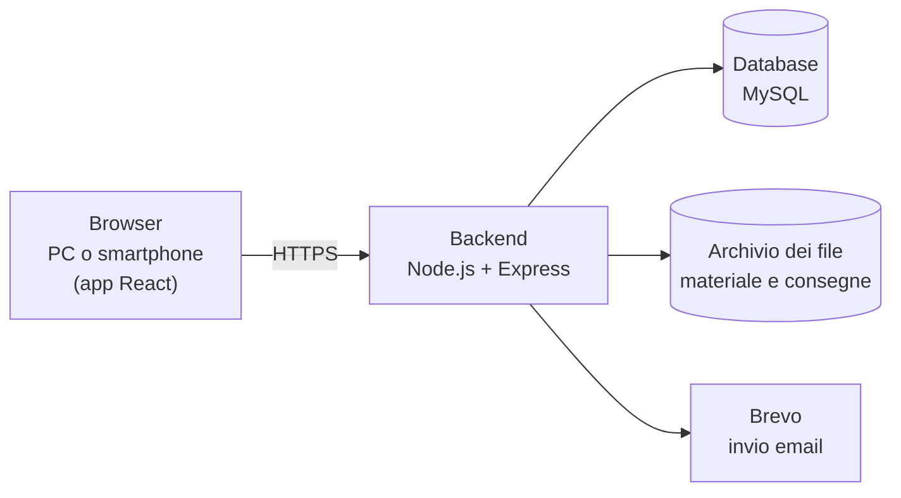

# PRD di ScuolaChill · Matteo Padesi

## Informazioni sul documento

|              |               |
| ------------ | ------------- |
| **Prodotto** | ScuolaChill   |
| **Team**     | x             |
| **Autori**   | Matteo Padesi |
| **Versione** | _1.0_         |
| **Data**     | 23/09/2026    |
| **Stato**    | Bozza         |

### Storico delle versioni

| Versione | Data       | Autore        | Cosa è cambiato e perché |
| -------- | ---------- | ------------- | ------------------------ |
| 1.0      | 23/09/2026 | Matteo Padesi | Prima stesura            |

---

# Prima parte · Il cosa

## Scopo e perimetro

### Perché esiste ScuolaChill

**Dal lato business.** A scuola materiale didattico, verifiche e voti passano spesso da strumenti diversi: email, chat, cartelle condivise, moduli online. ScuolaChill li riunisce in un solo posto. Il Direttore vede l'andamento della scuola senza chiedere i dati a ogni docente. I docenti preparano materiale, verifiche e voti senza fare lo stesso lavoro due volte. Gli studenti trovano in un'unica app, anche da smartphone, tutto ciò che serve per studiare e i propri voti.

**Dal lato tecnico.** Il sistema copre principalmente quattro aree: account e classi, materiale didattico, verifiche, voti e medie. Ogni utente vede solo ciò che serve al suo ruolo: Direttore, segreteria, docenti, coordinatori e studenti. Si usa dal browser, sia da PC sia da smartphone, ed è pubblicato su internet, così che possa essere collaudato da utenti reali.

### Cosa è incluso

- Accesso (login e logout) con account creati dalla segreteria o dal Direttore: nessuno si registra da solo
- Recupero della password dimenticata via email
- Creazione degli account di docenti e studenti da parte della segreteria o del Direttore, anche con file CSV con invio via email delle credenziali di primo accesso
- Gestione delle classi: composizione, assegnazione dei docenti per materia, trasferimento degli studenti, materie facoltative come religione
- Panoramica della scuola per il Direttore e vista della propria classe per i coordinatori
- Caricamento del materiale didattico da parte dei docenti e consultazione da parte degli studenti, per classe e materia, anche riservato solo ad alcuni studenti
- Verifiche: materiale che il docente segna come verifica, con un orario di apertura e uno di chiusura, l'eventuale consegna dell'elaborato da parte dello studente e la riapertura a scelta del docente
- Voti da 1 a 10 con "+", "½" e "−", giudizi per religione e attività alternativa, medie per studente, classe e materia
- Voti presi in un'altra scuola dagli studenti trasferiti
- Passaggio al nuovo anno scolastico, con archivio degli anni precedenti

### Cosa non è incluso

- **Scrutini, pagelle e registro ufficiale.**
- **Genitori.** Non hanno un account, e ScuolaChill non invia comunicazioni alle famiglie.
- **Messaggi fra utenti.** ScuolaChill non è uno strumento per comunicare.
- **Assenze, presenze e giustificazioni.**
- **Orario delle lezioni e calendario.**
- **Rette e pagamenti.**

---

## Stakeholder

| Stakeholder                 | Cosa fa                                                                                                     | Cosa gli interessa                                          | Come lo coinvolgete                              |
| --------------------------- | ----------------------------------------------------------------------------------------------------------- | ----------------------------------------------------------- | ------------------------------------------------ |
| Direttore                   | Dirige la scuola, crea account e classi, ha visione d'insieme                                               | Poco tempo, vuole vedere tutto senza entrare in ogni pagina | Intervista + collaudo finale                     |
| Docenti                     | Insegna una o più materie, carica materiale, crea verifiche, assegna voti                                   | Fare le operazioni quotidiane senza attrito                 | Collaudo con un docente reale                    |
| Studenti                    | Consulta materiale, svolge verifiche, controlla i voti                                                      | Trovare tutto in un posto, non perdere voti                 | Collaudo con i ragazzi del primo anno            |
| Collaudatori del primo anno | Usano ScuolaChill come utenti reali                                                                         | Che sia semplice da usare, anche da smartphone              | Intervista e collaudo                            |
| Segreteria                  | Crea gli account, compone le classi, gestisce trasferimenti e voti da altre scuole, su delega del Direttore | Caricare molti studenti in poco tempo, senza errori         | Collaudo con una persona della segreteria        |
| Coordinatori di classe      | Docenti che seguono una classe e supportano il Direttore                                                    | Avere il quadro della classe prima dei consigli di classe   | Indicazioni del coordinatore di classe, collaudo |

---

## Destinatari e contesto d'uso

### La scuola che avete immaginato

Progetto ScuolaChill per l'istituto **CFP Don Bosco** di San Donà di Piave.

- **Molte ore si passano in laboratorio**, nei settori elettrico, termoidraulico, informatico, meccanico e automotive. Docenti e studenti non sono sempre seduti davanti a un computer, quindi lo smartphone conta quanto il PC.
- **I percorsi non durano tutti uguale**: alcuni finiscono dopo tre anni, altri dopo quattro.

|                    | Valore                                                                                                                                                                                   |
| ------------------ | ---------------------------------------------------------------------------------------------------------------------------------------------------------------------------------------- |
| Tipo di istituto   | Centro di formazione professionale (IeFP)                                                                                                                                                |
| Percorsi           | 10: cinque qualifiche di tre anni e cinque diplomi di quattro anni                                                                                                                       |
| Numero di studenti | 412 _(dato del coordinatore di classe)_                                                                                                                                                  |
| Numero di docenti  | 50 _(dato del coordinatore di classe)_                                                                                                                                                   |
| Numero di classi   | 23, in media 18 studenti ciascuna _(dato del coordinatore di classe)_                                                                                                                    |
| Orario scolastico  | Dalle 8:10 alle 13:20 e dalle 14:00 alle 16:00                                                                                                                                           |
| Connettività       | Una sola rete Wi-Fi della scuola, in comune fra aule e laboratori, che rallenta quando molti dispositivi sono collegati. Per questo molti usano la connessione dati del proprio telefono |

### Gli archetipi

| ID      | Archetipo              | Contesto d'uso                                                                         | Competenze digitali                                                                | Dispositivo principale       | Frequenza d'uso                                                                                                               |
| ------- | ---------------------- | -------------------------------------------------------------------------------------- | ---------------------------------------------------------------------------------- | ---------------------------- | ----------------------------------------------------------------------------------------------------------------------------- |
| ARC-001 | Direttore              | Ufficio, tempo limitato                                                                | Medie, abituato a usare il PC per lavoro, vuole comunque viste rapide e sintetiche | PC                           | Più volte a settimana, con picchi a inizio anno (creazione classi) e sessioni più brevi per avere una panoramica della scuola |
| ARC-002 | Docente                | In classe o a casa                                                                     | Variabili, soprattutto in base all'età                                             | PC (principale) e smartphone | Più volte a settimana, con picchi dopo ogni verifica (assegnazione voti)                                                      |
| ARC-003 | Studente               | A scuola fra le lezioni, durante l'intervallo o a casa per studiare                    | Alte, soprattutto per quanto riguarda lo smartphone                                | PC e smartphone (principale) | Giornaliera, uso sia breve (vedere voti), che lungo (vedere materiale scolastico)                                             |
| ARC-004 | Segreteria             | Ufficio di segreteria, in orario d'ufficio; lavora su delega del Direttore             | Buone: usa ogni giorno PC, gestionali e fogli di calcolo                           | PC                           | Quotidiana, con picchi a inizio anno (account e classi) e quando arriva o si trasferisce uno studente                         |
| ARC-005 | Coordinatore di classe | È un docente (ARC-002) con un compito in più: segue una classe e supporta il Direttore | Come i docenti, variabili                                                          | PC                           | Qualche volta al mese, con picchi prima dei consigli di classe e a fine anno                                                  |

---

## Panoramica e casi d'uso

### ScuolaChill in poche righe

ScuolaChill è il posto unico in cui la scuola gestisce materiale, verifiche e voti. A inizio anno la segreteria crea gli account e le classi, e il Direttore da una sola pagina vede come va la scuola: le classi, i docenti, l'andamento dei voti. I docenti caricano il materiale e le verifiche, decidono quando una verifica si apre e si chiude, e registrano i voti. Gli studenti trovano tutto in un posto, anche dal telefono: il materiale per studiare, le verifiche da svolgere e consegnare, i propri voti con le medie. A fine anno, con pochi passaggi, le classi passano all'anno successivo senza perdere nulla.

### User flow e scenari

#### Direttore (ARC-001)

**Nota.** Nella pratica DIR-01, DIR-02 e DIR-03 le svolge la segreteria (ARC-004), su delega del Direttore.

**DIR-01 — Creare account docente:** Come Direttore voglio creare gli account dei docenti così da dare al personale l'accesso al sistema con il ruolo corretto.

**User flow**

1. Il Direttore apre "Crea account" e sceglie "Docente"
2. Inserisce nome, cognome, data di nascita, email e materie insegnate (le classi si possono aggiungere dopo)
3. Conferma: l'account compare nell'elenco dei docenti
4. Il docente riceve un'email con le credenziali di primo accesso

**Scenario principale.** Arriva un nuovo docente di matematica. Il Direttore crea il suo account inserendo i dati e la materia, ma lascia vuote le classi, perché non è ancora deciso dove insegnerà. Il docente riceve l'email, apre il link, accede con le credenziali e sceglie subito una nuova password.

**Scenari alternativi.**

- **Email già usata:** il Direttore inserisce un'email che appartiene già a un altro utente. Il sistema lo segnala e non crea l'account (AC-02).
- **L'email non parte:** il servizio delle email non risponde. L'account viene creato lo stesso, e la segreteria può reinviare l'email più tardi o consegnare le credenziali di persona (FR-EST-01).
- **Utente senza permesso:** un docente o uno studente prova a creare un account, anche senza passare dalle pagine dell'app. L'operazione viene negata (AC-03).

**DIR-02 — Creare account studente:** Come Direttore voglio creare gli account degli studenti così da permettere a ogni iscritto di usare l'applicazione.

**User flow**

1. Il Direttore apre "Crea account" e sceglie "Studente"
2. Inserisce nome, cognome, data di nascita, email e, se già decisa, la classe
3. Conferma: l'account compare nell'elenco degli studenti
4. Lo studente riceve un'email con le credenziali di primo accesso

**Scenario principale.** A metà ottobre si iscrive un nuovo studente. Il Direttore crea il suo account e lascia vuota la classe, che sceglierà più avanti. Lo studente riceve l'email, accede dal telefono e sceglie una nuova password.

**Scenari alternativi.**

- **Dati incompleti:** il Direttore conferma senza la data di nascita e con un'email scritta male. Il sistema indica esattamente i campi da correggere e non crea l'account (AC-02).
- **Omonimo:** esiste già uno studente con lo stesso nome e cognome. L'account viene creato lo stesso, perché due ragazzi possono chiamarsi davvero uguali, e negli elenchi compare anche la data di nascita per distinguerli.
- **Utente senza permesso:** un docente o uno studente prova a creare uno studente. L'operazione viene negata (AC-03).

**DIR-03 — Creare classi e comporle:** Come Direttore voglio creare le classi e assegnarvi studenti e docenti con le rispettive materie così da riprodurre l'organizzazione reale della scuola.

**User flow**

1. Il Direttore apre "Classi" e preme "Nuova classe"
2. Sceglie l'anno (da 1ª a 4ª) e la sezione (es. A); l'anno scolastico è sempre quello in corso
3. Con "Aggiungi studenti" sceglie gli studenti dall'elenco
4. Con "Aggiungi materia" sceglie le materie e, per ognuna, il docente
5. Salva: la classe compare nell'elenco

Le materie della scuola (es. italiano, religione) le crea il Direttore una volta sola, scegliendo se si valutano con voto o con giudizio.

**Scenario principale.** A settembre il Direttore crea la nuova 1A. Aggiunge i 18 studenti iscritti scegliendoli dall'elenco, poi assegna un docente a ogni materia, lasciando vuote quelle il cui docente non è ancora deciso. Le altre classi sono già pronte, perché il passaggio al nuovo anno le ha create partendo da quelle dell'anno prima (FR-ANN-01).

**Scenari alternativi.**

- **Nome già usato:** nell'anno in corso esiste già una 1A. Il sistema lo segnala e non crea la classe.
- **Studente già in un'altra classe:** il Direttore aggiunge alla 1A uno studente che è in 1B. Il sistema lo segnala e propone il trasferimento, che va confermato (FR-CLA-01).
- **Materia facoltativa:** per religione si indicano solo gli studenti che la seguono; gli altri non la vedranno (FR-MAT-01).

**DIR-04 — Vedere tutto:** Come Direttore voglio una vista complessiva su classi, docenti, studenti e voti così da monitorare l'andamento della scuola senza entrare in ogni singola pagina.

**User flow**

1. Il Direttore apre la "Panoramica"
2. Vede in una sola pagina le classi con il numero di studenti, i docenti con le loro materie e le medie
3. Se vuole i dettagli, apre l'elenco completo, diviso in pagine

**Scenario principale.** Il Direttore ha dieci minuti prima di una riunione con i docenti. Apre la Panoramica dal PC dell'ufficio e in una sola pagina vede classi, docenti e medie. Nota che la media di matematica della 2B è più bassa di quella delle altre seconde, e arriva alla riunione con il dato già pronto.

**Scenari alternativi.**

- **Elenco lungo:** l'elenco dei 412 studenti è diviso in pagine, e il Direttore le scorre una alla volta (AC-02).
- **Classe senza voti:** a inizio anno la 1A non ha ancora voti. La sua media non compare, invece di mostrare "0" (FR-VOT-03).
- **Utente senza permesso:** un docente o uno studente prova ad aprire la Panoramica. L'operazione viene negata (AC-03).

#### Docente (ARC-002)

**DOC-01 — Caricare materiale didattico:** Come Docente voglio caricare il materiale didattico per le mie materie e classi così da metterlo a disposizione degli studenti in un posto solo.

**User flow**

1. Il docente apre una sua classe e sceglie la materia
2. Preme "Carica materiale", sceglie il file e gli dà un titolo; se serve, lo rende visibile solo ad alcuni studenti (FR-MAT-02)
3. Conferma: il materiale compare agli studenti della classe

**Scenario principale.** La prof.ssa Bianchi insegna elettrotecnica in 3A e 3B. Dopo il laboratorio carica dal portatile le slide della lezione per la 3A. Gli studenti della 3A le trovano subito nella materia; quelli della 3B no, perché sono state caricate solo per la 3A.

**Scenari alternativi.**

- **Classe non sua:** la prof.ssa Bianchi non insegna in 3C, quindi la 3C non compare fra le sue classi. Se prova ad accedervi in un altro modo, l'operazione viene negata (AC-02).
- **Materiale di un collega:** prova a eliminare un file caricato da un collega. L'operazione viene negata, perché può modificare solo il proprio materiale (AC-03).
- **Connessione che cade:** il materiale compare solo quando il file è arrivato per intero; altrimenti la docente vede un errore e riprova.

**DOC-02 — Creare le proprie verifiche:** Come Docente voglio creare verifiche per le mie classi così da valutare gli studenti sulle mie materie.

**User flow**

1. Il docente apre una sua classe e sceglie la materia
2. Carica il file della verifica e lo segna come verifica
3. Imposta apertura e chiusura e sceglie se è "con consegna"
4. Salva: gli studenti vedono titolo e orari, ma possono aprire il file solo quando la verifica è aperta

**Scenario principale.** Il prof. Verdi vuole fare una verifica di italiano alla 2B giovedì. Lunedì carica il file con le domande, lo segna come verifica, la imposta aperta dalle 9:10 alle 10:10 e sceglie "con consegna": gli studenti scriveranno sul foglio e caricheranno la foto. Fino a giovedì gli studenti vedono solo titolo e orari.

**Scenari alternativi.**

- **Errore prima dell'apertura:** mercoledì il docente trova un errore nel testo. Può sostituire il file, perché la verifica non è ancora aperta (FR-VER-03).
- **Errore dopo l'apertura:** giovedì alle 9:20 il file non si può più cambiare. Il docente può solo spostare la chiusura per dare più tempo (FR-VER-03).
- **Verifica di un collega:** il docente prova a modificare la verifica di un altro docente. L'operazione viene negata (AC-03).

**DOC-03 — Assegnare i voti:** Come Docente voglio assegnare i voti delle mie verifiche così da registrare formalmente la valutazione di ogni studente.

**User flow**

1. Il docente apre una sua verifica
2. Vede gli studenti e, se la verifica è con consegna, i loro elaborati
3. Scrive il voto accanto a ogni studente (in religione sceglie un giudizio)
4. Salva: lo studente vede subito il voto

**Scenario principale.** Venerdì il prof. Verdi apre la verifica di italiano della 2B. Per ogni studente vede se ha consegnato e apre la foto del suo elaborato. Inserisce i voti (7−, 6½, 8…) e salva: ogni studente vede subito il proprio voto e la media aggiornata.

**Scenari alternativi.**

- **Voto fuori scala:** il docente scrive "11" o "10+". Il sistema mostra un errore e non registra il voto (AC-02).
- **Studente assente:** Luca era assente e non ha consegnato. Il docente lascia vuoto il suo voto e riapre la verifica solo per lui (FR-VER-02).
- **Verifica di un collega:** il docente prova a mettere voti in una verifica di un altro docente. L'operazione viene negata (AC-03).

#### Studente (ARC-003)

**STU-01 — Consultare il materiale didattico:** Come Studente voglio consultare il materiale caricato da ogni docente delle mie materie così da avere tutto ciò che serve per studiare in un unico posto.

**User flow**

1. Lo studente apre "Materie" e sceglie una materia
2. Apre o scarica il materiale

**Scenario principale.** Luca è in 3A. La sera prima dell'interrogazione apre ScuolaChill dal telefono, va in elettrotecnica e trova le slide caricate in giornata dalla prof.ssa Bianchi. Le apre e ripassa.

**Scenari alternativi.**

- **Materiale di un'altra classe:** un amico della 3B manda a Luca il link a un file della sua classe. Aprendolo, l'accesso viene negato (AC-02).
- **Materia facoltativa che non segue:** Luca non fa religione, quindi la materia non compare fra le sue (FR-MAT-01).

**STU-02 — Svolgere una verifica:** Come Studente voglio svolgere le verifiche assegnate alla mia classe così da essere valutato sulle materie che seguo.

**User flow**

1. Lo studente apre "Verifiche" e vede quelle della sua classe, con gli orari
2. Quando la verifica è aperta, apre il file e la svolge
3. Se è con consegna, carica il suo elaborato prima della chiusura
4. Vede la conferma "Consegna avvenuta"

**Scenario principale.** Giulia è in 2B. Giovedì alle 9:10 la verifica di italiano si apre: dal telefono apre il file e risponde sul foglio. Alle 10:00 fotografa il foglio, carica la foto e vede la conferma "Consegna avvenuta".

**Scenari alternativi.**

- **Connessione che cade:** il Wi-Fi si blocca mentre carica la foto. Giulia vede un errore, la consegna non risulta fatta, e riprova con i dati del telefono finché la verifica è aperta (FR-VER-04).
- **Seconda consegna:** dopo aver consegnato si accorge di un errore e prova a consegnare di nuovo. L'operazione viene negata (AC-02).
- **Verifica di un'altra classe:** Giulia apre il link a una verifica della 2C. L'accesso viene negato (AC-03).

**STU-03 — Consultare i propri voti:** Come Studente voglio consultare i miei voti raggruppati per materia così da sapere come sto andando in ciascuna.

**User flow**

1. Lo studente apre "I miei voti"
2. Vede i voti divisi per materia, con la verifica da cui vengono e la media

**Scenario principale.** Prima dei colloqui con i genitori, Giulia apre "I miei voti" dal telefono. In italiano vede 7− e 6½, ognuno con la verifica da cui viene, e la media 6,63. In religione vede il giudizio "buono", senza media.

**Scenari alternativi.**

- **Voti di un compagno:** Giulia prova ad aprire i voti di un compagno modificando il link. L'accesso viene negato (AC-02).
- **Materia senza voti:** a inizio anno una materia non ha ancora voti. La media non compare, invece di mostrare "0" (FR-VOT-03).
- **Cambio di classe:** Giulia viene trasferita dalla 2B alla 2C a metà anno. I voti presi in 2B restano fra i suoi (FR-CLA-01).

#### Segreteria (ARC-004)

**SEG-01 — Importare gli studenti da un file:** Come Segreteria voglio caricare gli studenti da un file CSV così da non doverli inserire uno alla volta.

- AC-01 · Dato che il file è corretto, Quando lo carico, Allora vengono creati tutti gli account e partono le email con le credenziali.
- AC-02 · Dato che il file ha righe sbagliate, Quando lo carico, Allora vedo le righe da correggere e non viene creato nessun account.

**User flow**

1. La segreteria apre "Studenti" e preme "Importa da file"
2. Carica il file (nome, cognome, data di nascita, email, classe)
3. Se ci sono errori, il sistema elenca le righe da correggere e non importa nulla
4. Altrimenti conferma: gli account vengono creati e le credenziali inviate

**SEG-02 — Inserire voti da un'altra scuola:** Come Segreteria voglio inserire i voti che uno studente trasferito ha preso nella scuola di provenienza così da non perdere il suo percorso.

- AC-01 · Dato che uno studente arriva da un'altra scuola, Quando inserisco un suo voto, Allora il voto compare fra i suoi, segnato come "da altra scuola", e conta nella media.

**User flow**

1. La segreteria apre la pagina dello studente e preme "Aggiungi voto da altra scuola"
2. Sceglie la materia e inserisce voto, data e nome della scuola
3. Salva: il voto compare fra quelli dello studente

#### Coordinatore di classe (ARC-005)

**COO-01 — Seguire la propria classe:** Come Coordinatore di classe voglio vedere voti e medie di tutte le materie della mia classe così da accorgermi in tempo degli studenti in difficoltà.

- AC-01 · Dato che sono coordinatore di una classe, Quando apro "La mia classe", Allora vedo voti e medie di ogni studente in tutte le materie.
- AC-02 · Dato che non sono coordinatore di una classe, Quando provo ad aprirne la vista completa, Allora l'operazione viene negata.

**User flow**

1. Il coordinatore apre "La mia classe"
2. Vede gli studenti con le loro medie in ogni materia; aprendo uno studente vede i singoli voti

**COO-02 — Indicare gli esiti di fine anno:** Come Coordinatore di classe voglio indicare a fine anno chi è ammesso, chi non lo è e chi lascia la scuola così che il Direttore debba solo confermare il passaggio al nuovo anno.

- AC-01 · Dato che è fine anno, Quando indico l'esito di ogni studente della mia classe, Allora la proposta del nuovo anno ne tiene conto (FR-ANN-01).

**User flow**

1. Il coordinatore apre "La mia classe" e preme "Esiti di fine anno"
2. Per ogni studente sceglie: ammesso, non ammesso, lascia la scuola
3. Salva: il Direttore troverà gli esiti quando avvia il nuovo anno

---

## Requisiti funzionali

### Le user story della traccia

| ID     | Storia                            | AC aggiunti                                                                                                                                            | Note                                    |
| ------ | --------------------------------- | ------------------------------------------------------------------------------------------------------------------------------------------------------ | --------------------------------------- |
| DIR-01 | Creare account docente            | AC-04 · Dato che il servizio email non risponde, Quando creo un docente, Allora l'account viene creato comunque e compare come "email non consegnata". | FR-EST-01                               |
| DIR-02 | Creare account studente           | AC-04 · Dato che esiste già uno studente con lo stesso nome e cognome, Quando ne creo un altro, Allora il sistema avvisa ma crea l'account.            | Scenario "Omonimo"                      |
| DIR-03 | Creare classi e comporle          | AC-04 · Dato che nell'anno in corso esiste già la 1A, Quando creo un'altra 1A, Allora ricevo un errore e la classe non viene creata.                   | Nome unico nello stesso anno scolastico |
| DIR-04 | Vedere tutto                      | AC-04 · Dato che religione si valuta con giudizio, Quando apro la panoramica, Allora i giudizi compaiono separati dalle medie.                         | FR-VOT-02                               |
| DOC-01 | Caricare materiale didattico      | AC-04 · Dato che ho caricato un materiale riservato ad alcuni studenti, Quando un altro studente della classe apre la materia, Allora non lo vede.     | FR-MAT-02                               |
| DOC-02 | Creare le proprie verifiche       | AC-04 · Dato che la mia verifica è già aperta, Quando provo a sostituirne il file, Allora l'operazione viene negata.                                   | FR-VER-03                               |
| DOC-03 | Assegnare i voti                  | AC-04 · Dato che la materia si valuta con giudizio, Quando inserisco un voto numerico, Allora ricevo un errore.                                        | FR-VOT-02                               |
| STU-01 | Consultare il materiale didattico | AC-03 · Dato che non seguo una materia facoltativa, Quando apro le mie materie, Allora non la vedo.                                                    | FR-MAT-01                               |
| STU-02 | Svolgere una verifica             | AC-04 · Dato che la verifica non è ancora aperta, Quando provo ad aprirne il file, Allora l'operazione viene negata.                                   | FR-VER-02                               |
| STU-03 | Consultare i propri voti          | AC-03 · Dato che una materia non ha ancora voti, Quando apro la pagina dei voti, Allora la media non compare (non "0").                                | FR-VOT-03                               |

### Le decisioni lasciate aperte dalla traccia

La traccia lascia alcune scelte aperte. Ognuna è diventata un requisito con il suo ID.

- [x] La scala dei voti (DOC-03). Da quanto a quanto, con quale passo, se ammette segni come "+" e "−".
- [x] Il trasferimento di uno studente fra classi (DIR-03). Si può fare? Cosa succede ai voti?
- [x] La modifica di una verifica dopo lo svolgimento (DOC-02).
- [x] La connessione che cade durante una verifica (STU-02).
- [x] Il fallimento del servizio esterno (per esempio l'email delle credenziali).
- [x] Le materie che non tutti seguono, come religione.
- [x] Il passaggio al nuovo anno scolastico.
- [x] Che cos'è una verifica e chi la corregge.
- [x] Dove si vedono le medie e come si calcolano.
- [x] Cosa succede se un utente dimentica la password.
- [x] Materiale riservato ad alcuni studenti.

> **FR-VOT-01 · Scala dei voti** (collegato a DOC-03, STU-03)
> Voti da 1 a 10 con "+", "½" e "−", come sul registro. Nelle medie "+" vale 0,25 in più, "½" 0,5 in più, "−" 0,25 in meno.
> **Motivazione:** è la scala che docenti e studenti usano già.

> **FR-CLA-01 · Trasferimento di uno studente** (collegato a DIR-03)
> Uno studente sta in una sola classe. Per spostarlo si usa "Trasferisci", e i suoi voti restano suoi.
> **Motivazione:** i voti sono dello studente, non della classe.

> **FR-VER-01 · Cos'è una verifica** (collegato a DOC-01, DOC-02, DOC-03, STU-02)
> È un file caricato dal docente, con un orario di apertura e uno di chiusura. Può essere **con consegna** (lo studente carica il suo elaborato) o **senza consegna** (si svolge su carta o con strumenti come Google Moduli). Il voto lo mette sempre il docente.
> **Motivazione:** così vale sia per le verifiche scritte sia per le prove di laboratorio.

> **FR-VER-02 · Apertura, chiusura e riapertura** (collegato a DOC-02, STU-01, STU-02)
> Lo studente può aprire il file e consegnare solo mentre la verifica è aperta. Il docente può riaprirla per tutta la classe o solo per alcuni studenti (es. un assente).
> **Motivazione:** il testo non deve girare né prima né dopo la verifica.

> **FR-VER-03 · Modifica dopo l'apertura** (collegato a DOC-02, DOC-03)
> Prima dell'apertura si può cambiare tutto; dopo si può solo spostare la chiusura, riaprire la verifica e mettere i voti.
> **Motivazione:** tutti devono fare la stessa verifica.

> **FR-VER-04 · Connessione che cade durante la consegna** (collegato a STU-02)
> La consegna vale solo quando lo studente vede la conferma. Se la connessione cade, riprova finché la verifica è aperta; se si chiude prima, il docente può riaprirla solo per lui.
> **Motivazione:** con il Wi-Fi della scuola succede spesso.

> **FR-EST-01 · Email che non parte** (collegato a DIR-01, DIR-02)
> L'account viene creato lo stesso, e il sistema riprova a inviare l'email. Se non ci riesce, la segreteria può reinviarla o consegnare le credenziali di persona. Al primo accesso la password va cambiata.
> **Motivazione:** un servizio esterno non deve bloccare il lavoro della segreteria.

> **FR-ACC-01 · Password dimenticata** (collegato a tutte le storie che richiedono l'accesso)
> Dalla pagina di accesso si riceve via email un link per scegliere una nuova password, valido 30 minuti. Se l'email non arriva, ci si rivolge alla segreteria.
> **Motivazione:** con 412 studenti le password dimenticate saranno frequenti.

> **FR-MAT-01 · Materie facoltative** (collegato a DIR-03, DOC-01, DOC-02, DOC-03, STU-01, STU-02, STU-03)
> Una materia può essere facoltativa (es. religione): chi non la segue non la vede, e il docente vede solo chi la segue. Chi la segue lo indica il coordinatore della classe.
> **Motivazione:** non tutti fanno religione.

> **FR-MAT-02 · Materiale riservato ad alcuni studenti** (collegato a DOC-01, STU-01)
> Il docente può rendere un materiale visibile solo ad alcuni studenti (es. studenti con DSA); gli altri non sanno che esiste.
> **Motivazione:** è un'informazione delicata.

> **FR-VOT-02 · Materie valutate con giudizio** (collegato a DOC-03, STU-03, DIR-04)
> Religione e attività alternativa si valutano con un giudizio (da insufficiente a ottimo), che non entra nelle medie.
> **Motivazione:** è la regola della scuola italiana.

> **FR-VOT-03 · Medie** (collegato a STU-03, DOC-03, DIR-04)
> Le medie si calcolano sui voti dell'anno in corso. Lo studente vede le sue, il docente e il coordinatore quelle delle loro classi, il Direttore tutte. Se non ci sono voti, la media non compare (non "0").
> **Motivazione:** ognuno capisce subito come sta andando.

> **FR-ANN-01 · Passaggio al nuovo anno scolastico** (collegato a DIR-03, DIR-04, STU-03)
> A fine anno il sistema propone le classi dell'anno dopo (es. 2A → 3A) in base agli esiti indicati dai coordinatori, e il Direttore controlla e conferma. Le classi vecchie restano consultabili ma non modificabili. Chi lascia la scuola non può più accedere, ma i suoi voti restano.
> **Motivazione:** ricreare 23 classi ogni anno sarebbe lungo e pieno di errori.

---

## Requisiti non funzionali

Ogni requisito ha una soglia, una condizione e un modo per verificarlo. Ed è collegato ad almeno una user story.

| ID     | Famiglia      | Requisito                                                | Soglia e condizione                                                                                                                                                                                 | Come si verifica                                                                   | Storie collegate                                                                                     |
| ------ | ------------- | -------------------------------------------------------- | --------------------------------------------------------------------------------------------------------------------------------------------------------------------------------------------------- | ---------------------------------------------------------------------------------- | ---------------------------------------------------------------------------------------------------- |
| NFR-01 | Prestazioni   | Apertura della verifica nel picco                        | Il file della verifica inizia ad arrivare entro 2 s per il 95% delle richieste, con 150 studenti che lo aprono nello stesso minuto                                                                  | Test di carico che simula 150 studenti                                             | STU-02, DOC-02                                                                                       |
| NFR-02 | Sicurezza     | Tutto il traffico viaggia su HTTPS                       | 100% delle richieste; una richiesta in HTTP viene reindirizzata su HTTPS                                                                                                                            | Chiamata a `http://` con Postman: risposta di redirect verso `https://`            | Tutte                                                                                                |
| NFR-03 | Sicurezza     | Controllo dei ruoli nel backend                          | Ogni operazione non permessa al ruolo viene negata anche chiamando l'API direttamente, senza passare dall'interfaccia                                                                               | Collezione Postman con una chiamata per ogni ruolo non autorizzato                 | DIR-01..04 AC-03, DOC-01 AC-02, DOC-02 AC-03, DOC-03 AC-03, STU-01 AC-02, STU-02 AC-03, STU-03 AC-02 |
| NFR-04 | Sicurezza     | Nessun segreto nel codice sorgente                       | 0 password o chiavi (comprese quelle del database) scritte nel codice                                                                                                                               | Ricerca nel repository prima di ogni consegna                                      | Tutte                                                                                                |
| NFR-05 | Scalabilità   | Elenchi paginati                                         | Ogni elenco restituisce al massimo 25 elementi per pagina: una classe intera (circa 18 studenti) sta in una sola pagina                                                                             | Test Postman sugli elenchi di studenti, materiali e voti                           | DIR-04 AC-02, STU-01, STU-03                                                                         |
| NFR-06 | Interazione   | Errori in formato uniforme                               | 100% delle risposte di errore hanno lo stesso formato e un codice HTTP coerente                                                                                                                     | Test Postman sulle risposte di errore                                              | Tutte                                                                                                |
| NFR-07 | Supporto      | API documentate e verificabili                           | Ogni API principale è documentata in OpenAPI/Swagger e ha almeno una richiesta nella collezione Postman                                                                                             | Confronto fra la documentazione Swagger e la collezione                            | Tutte                                                                                                |
| NFR-08 | Supporto      | Configurazioni Development e Production                  | L'applicazione gira in entrambe le configurazioni senza modificare il codice                                                                                                                        | Avvio in entrambe le configurazioni                                                | Tutte                                                                                                |
| NFR-09 | Disponibilità | Raggiungibile pubblicamente per il collaudo              | Disponibile almeno il 99% del tempo dalle 8:00 alle 16:00 dei giorni di lezione; gli aggiornamenti si fanno fuori da questo orario                                                                  | Un controllo automatico apre il sito ogni 5 minuti e registra quando non risponde  | Tutte                                                                                                |
| NFR-10 | Usabilità     | Facile da usare dallo smartphone, anche al primo accesso | Almeno 9 ragazzi del primo anno su 10, al primo uso e senza aiuto, trovano un materiale e consegnano una verifica dallo smartphone                                                                  | Osservazione durante il collaudo con i ragazzi del primo anno                      | STU-01, STU-02                                                                                       |
| NFR-11 | Ambientale    | Funziona sui dispositivi usati a scuola                  | Tutte le funzioni si usano dalle ultime due versioni di Chrome, Safari, Firefox ed Edge, su smartphone Android e iPhone e sui PC dei laboratori, anche con schermi larghi 360 pixel                 | Prova di ogni storia su almeno un dispositivo per tipo                             | Tutte                                                                                                |
| NFR-12 | Conformità    | Dati personali ridotti al minimo                         | Per ogni utente si raccolgono solo nome, cognome, data di nascita (per distinguere gli omonimi) ed email; nessun altro dato anagrafico                                                              | Revisione dei campi richiesti nella creazione degli account e nel modello dei dati | DIR-01, DIR-02                                                                                       |
| NFR-13 | Prestazioni   | Consegna della verifica nel picco                        | Con 150 studenti che consegnano negli ultimi 5 minuti prima della chiusura, nessuna consegna arrivata per intero viene persa, e ogni studente vede la conferma entro 5 s dalla fine del caricamento | Test di carico che simula 150 consegne di file da 3 MB                             | STU-02, FR-VER-04                                                                                    |

### Requisiti impliciti

Cosa è emerso dal confronto con il docente del corso e con i compagni.

| Chi avete intervistato                                 | Cosa ha detto                                                                                                                    | Requisito che ne avete ricavato                                    |
| ------------------------------------------------------ | -------------------------------------------------------------------------------------------------------------------------------- | ------------------------------------------------------------------ |
| Docente del corso e compagni, durante le presentazioni | Il Direttore non fa tutto da solo: si appoggia alla segreteria per caricare gli studenti e ai coordinatori per seguire le classi | Archetipi ARC-004 e ARC-005, storie SEG-01, SEG-02, COO-01, COO-02 |
| Docente del corso e compagni, durante le presentazioni | Gli studenti non devono confondersi fra loro, nemmeno con le abbreviazioni dei nomi                                              | Scenario "Omonimo" di DIR-02                                       |
| Docente del corso e compagni, durante le presentazioni | Uno studente trasferito non deve perdere i voti presi nell'altra scuola                                                          | SEG-02                                                             |
| Docente del corso e compagni, durante le presentazioni | Agli studenti in difficoltà può servire materiale solo per loro                                                                  | FR-MAT-02                                                          |

---

## Assunzioni, vincoli e dipendenze

### Assunzioni

Quello che date per vero senza poterlo garantire.

| ID     | Assunzione                                                                                                                                   | Cosa succede se è falsa                                                                                                                                                                       |
| ------ | -------------------------------------------------------------------------------------------------------------------------------------------- | --------------------------------------------------------------------------------------------------------------------------------------------------------------------------------------------- |
| ASS-01 | Ogni studente e ogni docente ha un indirizzo email personale funzionante                                                                     | Le credenziali di primo accesso e il recupero della password via email non funzionano per tutti: per chi non ha email resta solo la consegna di persona da parte della segreteria (FR-EST-01) |
| ASS-02 | Ogni studente può usare uno smartphone con un browser aggiornato, oppure un PC del laboratorio durante le verifiche                          | Bisogna prevedere postazioni della scuola per chi non ha un dispositivo adatto                                                                                                                |
| ASS-03 | Nelle settimane con più verifiche (prima di Natale e a fine anno) al massimo un terzo delle classi (8 su 23) ha una verifica alla stessa ora | Il picco supera i 200 utenti: il dimensionamento va rivisto                                                                                                                                   |

### Vincoli

I limiti che non potete cambiare.

| ID     | Vincolo                                                                                                                 | Da dove viene                       |
| ------ | ----------------------------------------------------------------------------------------------------------------------- | ----------------------------------- |
| VIN-01 | I costi del cloud devono stare nel piano gratuito o in pochi euro al mese                                               | Budget personale di uno studente    |
| VIN-02 | Traffico su HTTPS, API documentate con OpenAPI, configurazioni Development e Production, sistema pubblicato su internet | Requisiti trasversali della traccia |
| VIN-03 | Il collaudo lo fanno utenti reali: ragazzi del primo anno, il Direttore e un docente                                    | Traccia del progetto                |

### Dipendenze

Le cose esterne senza cui non potete andare avanti.

| ID     | Dipendenza                                                | Serve entro        | Chi se ne occupa |
| ------ | --------------------------------------------------------- | ------------------ | ---------------- |
| DIP-01 | Account Brevo attivo, con l'indirizzo mittente verificato | Prima del collaudo | Matteo Padesi    |

---

# Seconda parte · Il come

## Stima del carico

### Utenti concorrenti

Per "utenti concorrenti" intendo le persone che usano ScuolaChill nello stesso intervallo di 5 minuti. La base sono circa 465 account: 412 studenti, 50 docenti, il Direttore e la segreteria.

| Situazione                                       | Utenti concorrenti | Da dove viene il numero                                                                                                        |
| ------------------------------------------------ | ------------------ | ------------------------------------------------------------------------------------------------------------------------------ |
| Uso normale durante la giornata                  | ~50                | Circa il 10% degli account attivo nello stesso momento durante le lezioni                                                      |
| Picco di verifiche in un giorno normale          | ~105               | 3 classi da 18 studenti che aprono una verifica alla stessa ora (54), più l'uso normale (50)                                   |
| Picco di verifiche prima di Natale e a fine anno | **~200**           | Fino a un terzo delle classi (8 su 23) ha una verifica alla stessa ora (ASS-03): 8 × 18 = 144 studenti, più l'uso normale (50) |
| Fine quadrimestre (voti)                         | ~150               | La sera circa il 25% degli studenti controlla i voti (circa 100), più i 50 docenti che li inseriscono                          |

**Il caso peggiore è il picco di verifiche prima di Natale e a fine anno.** Circa 150 studenti aprono il file della verifica nello stesso minuto, e poi caricano la foto dell'elaborato negli ultimi minuti prima della chiusura: con foto/file da circa 3 MB sono circa 430 MB in pochi minuti. Il sistema va dimensionato su questo caso (NFR-01, NFR-13). Anche il Wi-Fi della scuola può non reggere: per questo, se il caricamento fallisce, lo studente può riprovare anche con i dati del telefono (FR-VER-04).

### Profilo di carico

| Operazione              | Frequente?         | Pesante? | Critica? | Note                                                                                                                                                           |
| ----------------------- | ------------------ | -------- | -------- | -------------------------------------------------------------------------------------------------------------------------------------------------------------- |
| Login                   | Solo a inizio anno | No       | Sì       | Si fa una volta e poi si resta collegati: il picco c'è solo a inizio anno, quando tutti accedono per la prima volta. Se non funziona, non funziona nient'altro |
| Apertura verifica       | No, ma concentrata | Media    | Sì       | Molti studenti scaricano lo stesso file nello stesso minuto, e deve aprirsi all'orario esatto (NFR-01)                                                         |
| Consegna verifica       | No, ma concentrata | Sì       | Sì       | Caricamento di foto o documenti negli ultimi minuti prima della chiusura; una consegna persa è un danno per lo studente (NFR-13, FR-VER-04)                    |
| Dashboard del Direttore | No                 | Sì       | No       | Calcola medie e conteggi su tutta la scuola, ma la usa una persona sola; si può velocizzare preparando i dati in anticipo                                      |
| Caricamento materiale   | Abbastanza         | Sì       | No       | File da qualche MB, più volte al giorno; se fallisce il docente riprova                                                                                        |
| Consultazione voti      | Sì                 | No       | No       | L'operazione più frequente degli studenti, soprattutto a fine quadrimestre; sono letture semplici                                                              |
| Assegnazione voti       | Abbastanza         | No       | Sì       | Un voto salvato non deve mai andare perso                                                                                                                      |

---

## Scelte tecnologiche

**I criteri.** Tutte le scelte seguono quattro criteri, in quest'ordine:

1. **Un solo linguaggio.** Frontend e backend in JavaScript: imparo meno cose nuove e passo dall'uno all'altro senza cambiare linguaggio.
2. **Strumenti che conosco o sto imparando.** Abbiamo imparato MySQL e stiamo imparando React.
3. **Diffusione e documentazione.** Lavoro da solo: mi servono strumenti con tanti esempi e una comunità ampia.
4. **Costi bassi.** Tutto deve stare nel piano gratuito o costare pochi euro al mese.

| Area                      | Scelta                  | Alternative scartate      | Motivazione                                                                                                                                                                                                       |
| ------------------------- | ----------------------- | ------------------------- | ----------------------------------------------------------------------------------------------------------------------------------------------------------------------------------------------------------------- |
| Backend                   | **Node.js + Express**   | ASP.NET Core; Spring Boot | Stesso linguaggio del frontend e tantissimi esempi online. **ASP.NET Core** e **Spring Boot** scartati: hanno più funzioni pronte, ma userei un linguaggio diverso dal frontend.                                  |
| Frontend                  | **React**               | Angular; Next.js          | Lo stiamo imparando e ha molti componenti pronti. **Angular** scartato: è più complesso. **Next.js** scartato: i suoi vantaggi servono soprattutto ai siti pubblici, mentre ScuolaChill è tutta dietro login.     |
| Database                  | **MySQL**               | PostgreSQL                | Lo conosco già, e i dati di ScuolaChill hanno regole precise che un database relazionale fa rispettare. **PostgreSQL** scartato: è simile, ma non lo conosco.                                                     |
| Provider cloud            | **AWS**                 | Azure; Google Cloud       | È il più diffuso, con molta documentazione e un piano gratuito (_da verificare_). **Azure** scartato: il suo punto di forza è .NET, che non uso. **Google Cloud** scartato: i crediti di prova durano pochi mesi. |
| Regione                   |                         |                           |                                                                                                                                                                                                                   |
| Hosting dell'applicazione |                         |                           |                                                                                                                                                                                                                   |
| Archiviazione dei file    |                         |                           |                                                                                                                                                                                                                   |
| Autenticazione            |                         |                           |                                                                                                                                                                                                                   |
| Servizio esterno          | **Brevo** (invio email) | Amazon SES                | Piano gratuito con circa 300 email al giorno (_da verificare_), che bastano per ScuolaChill. **Amazon SES** scartato: all'inizio invia email solo a indirizzi verificati.                                         |

---

## Architettura

### Diagramma dei componenti

**Come funziona.**

1. L'utente apre ScuolaChill dal browser, sul PC o sul telefono.
2. Ogni azione (aprire una verifica, salvare un voto) diventa una richiesta al backend, sempre su HTTPS.
3. Il backend controlla chi fa la richiesta e se può farla, poi legge o scrive i dati nel database e i file nell'archivio.
4. Per inviare le email (credenziali e reset della password) il backend usa Brevo.

### I livelli

| Livello                | Cosa fa in ScuolaChill                    | Esempio concreto                                                                                   |
| ---------------------- | ----------------------------------------- | -------------------------------------------------------------------------------------------------- |
| Presentation / API     | Riceve le richieste e controlla chi le fa | Uno studente che prova a creare un account viene fermato qui                                       |
| Application / Business | Applica le regole della scuola            | Controlla che un voto sia nella scala (FR-VOT-01) e che la verifica sia del docente che lo assegna |
| Data access            | Legge e scrive i dati                     | Salva il voto nel database                                                                         |

### Le dipendenze fra i livelli

Ogni livello usa solo quello sotto di sé: la richiesta arriva al primo, che chiama il secondo, che chiama il terzo. Così ogni parte ha un solo compito. Se un giorno cambio database, cambia solo il terzo livello, e le regole della scuola si possono provare anche senza un database vero.

---

## Chi può fare cosa

| Operazione                                                 | Direttore | Segreteria | Docente                                      | Coordinatore                                | Studente                                          |
| ---------------------------------------------------------- | --------- | ---------- | -------------------------------------------- | ------------------------------------------- | ------------------------------------------------- |
| Creare account e comporre le classi                        | ✅        | ✅         | ❌                                           | ❌                                          | ❌                                                |
| Importare studenti da file e inserire voti da altre scuole | ✅        | ✅         | ❌                                           | ❌                                          | ❌                                                |
| Vedere la panoramica della scuola                          | ✅        | ❌         | ❌                                           | ❌                                          | ❌                                                |
| Avviare il nuovo anno scolastico                           | ✅        | ❌         | ❌                                           | ❌                                          | ❌                                                |
| Indicare gli esiti di fine anno                            | ✅        | ❌         | ❌                                           | ✅ solo la sua classe                       | ❌                                                |
| Caricare materiale e creare verifiche                      | ❌        | ❌         | ✅ solo nelle sue classi e materie           | ✅ come docente                             | ❌                                                |
| Vedere il materiale                                        | ✅        | ❌         | ✅ solo il suo                               | ✅ come docente                             | ✅ solo della sua classe, nelle materie che segue |
| Svolgere una verifica e consegnare                         | ❌        | ❌         | ❌                                           | ❌                                          | ✅ solo mentre è aperta, una volta sola           |
| Assegnare voti                                             | ❌        | ❌         | ✅ solo nelle sue verifiche                  | ✅ come docente                             | ❌                                                |
| Vedere i voti                                              | ✅ tutti  | ❌         | ✅ solo dei suoi studenti, nelle sue materie | ✅ tutta la sua classe, in tutte le materie | ✅ solo i propri                                  |

Il coordinatore è un docente nominato dal Direttore. Questi controlli li fa sempre il backend: l'app nasconde i bottoni che un utente non può usare, ma se qualcuno prova lo stesso, il backend rifiuta l'operazione (NFR-03).

---

# Terza parte · Tempi

## Milestone

| Milestone                    | Cosa è pronto    | Data prevista | Responsabile    |
| ---------------------------- | ---------------- | ------------- | --------------- |
| PRD validato                 | Questo documento | _…_           | _tutto il team_ |
| _Prima versione in cloud_    | _…_              | _…_           | _…_             |
| _Collaudo con il primo anno_ | _…_              | _…_           | _…_             |
| _…_                          |                  |               |                 |
